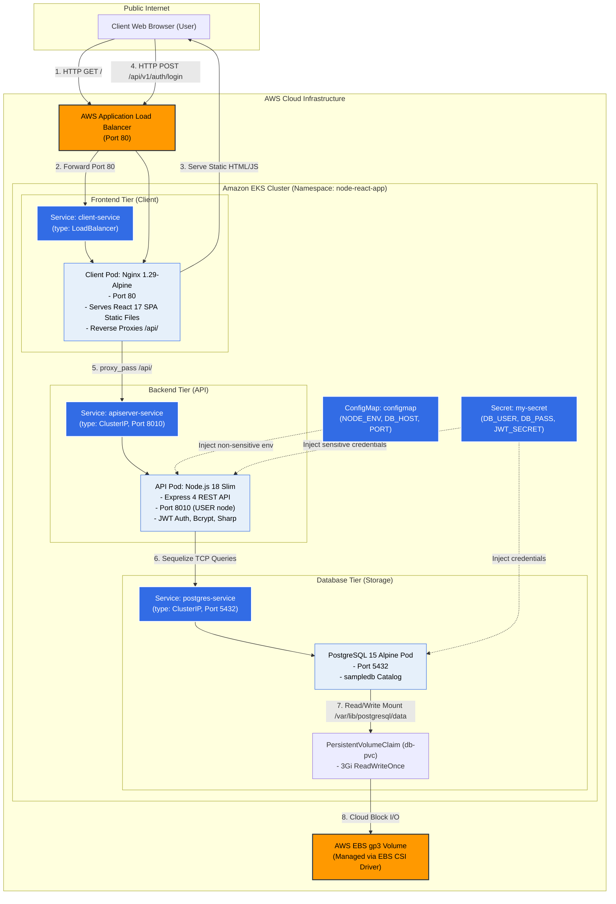
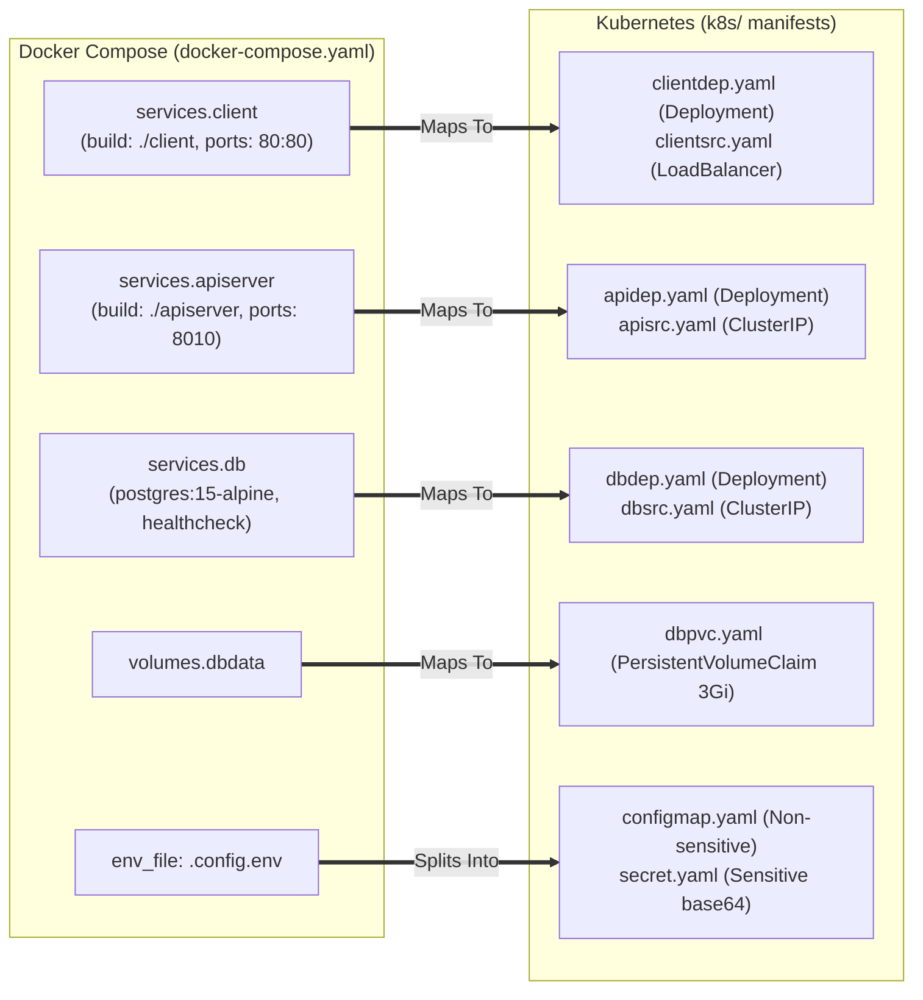
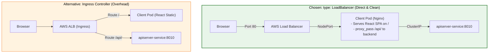
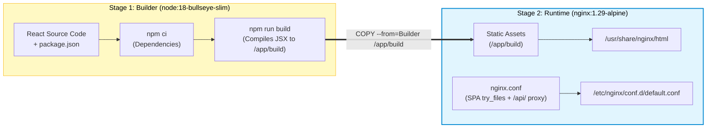
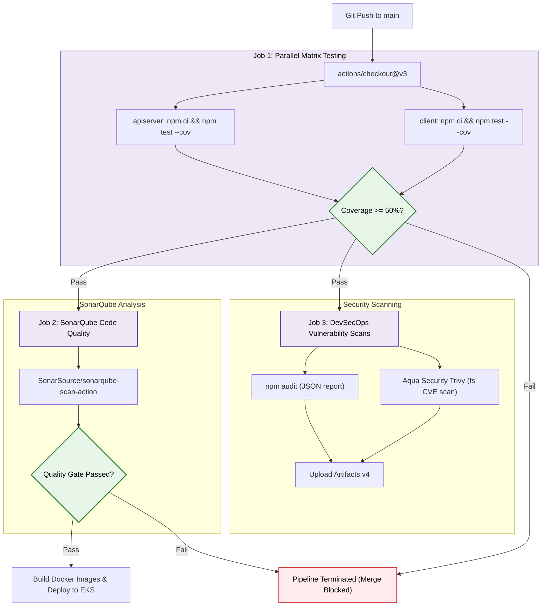
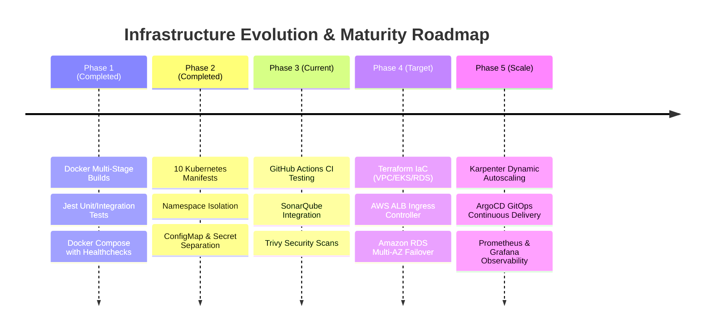

# Architecture Decision Record (ADR) & System Blueprint

> **Project:** FullStack DevOps Pipeline — Skills Management Platform  
> **Scope:** Containerization, Kubernetes Orchestration, CI/CD Automation, Networking, and Cloud Infrastructure  
> **Status:** Active Reference Blueprint

---

## 1. Executive System Overview

The platform is a cloud-native 3-tier web application built to manage professional skill portfolios. The architecture decouples static frontend asset delivery, RESTful API services, and relational database persistence into independently scalable, isolated containerized workloads.

### Complete System Architecture & Network Flow

---

## 2. Architecture Decision Records (ADRs)

---

### ADR-001: Container Orchestration Strategy (Docker Compose $\to$ Kubernetes)

#### Context & Problem Statement
Developers require rapid feedback loops and local debugging capabilities on single machines, while production workloads demand automated self-healing, rolling updates, autoscaling, and cloud resource abstraction.

#### Decision
* **Local Development:** Use **Docker Compose** for lightweight, multi-container orchestration.
* **Production Deployment:** Use **Kubernetes (Amazon EKS manifests)** for declarative orchestration.

#### Mapping Blueprint: Docker Compose $\to$ Kubernetes

---

### ADR-002: Client Routing (Service LoadBalancer vs. Ingress Controller)

#### Context & Problem Statement
The React frontend and Express backend need external reachability. The architectural question is whether to deploy an Ingress Controller (e.g. AWS Load Balancer Controller) or expose the client Nginx pod directly via `type: LoadBalancer`.

#### Decision
Use **`type: LoadBalancer`** directly on `clientsrc.yaml`. Do **not** deploy an extra Ingress Controller layer for this single-frontend architecture.

#### Rationale & Trade-Off Matrix

| Dimension | `type: LoadBalancer` (Selected) | Ingress Controller (Alternative) |
| :--- | :--- | :--- |
| **Architectural Simplicity** | **High:** 1 Service manifest (`clientsrc.yaml`). | **Low:** Requires Ingress resource + Controller pod + IAM OIDC roles. |
| **Infrastructure Cost** | **Free-tier eligible** AWS ALB. | Extra controller resources + provisioned ALB (~$20+/month). |
| **Routing Logic** | Handled natively by Nginx inside the client pod. | Handled at the AWS ALB Layer 7 rule level. |
| **When to Switch** | Current fit for 3-tier architecture. | Required when managing 10+ microservices or multi-domain SSL hosting. |

---

### ADR-003: Multi-Stage Docker Containerization

#### Context & Problem Statement
React Single Page Applications require a Node.js build runtime with extensive devDependencies (Webpack, Babel, React-Scripts) during compilation, but only require a lightweight static web server during production runtime.

#### Decision
Implement a **2-stage multi-stage build** in [`client/Dockerfile`](file:///d:/javascript_project/node-react-postgres/client/Dockerfile).

#### Metrics & Security Optimization
* **Image Size Reduction:** Discards the ~1.2 GB Node runtime; the final production image is **only ~23 MB**.
* **Attack Surface Elimination:** No Node.js runtime, npm cache, or development dependencies exist in the production container image.

---

### ADR-004: Automated CI/CD Pipeline & Quality Gates

#### Context & Problem Statement
Unvalidated code, breaking dependencies, and security vulnerabilities must be blocked automatically before building and pushing container images to the registry.

#### Decision
Implement a multi-job **GitHub Actions** pipeline with sequential quality gates.

---

## 3. Production Readiness & Roadmap Evolution

