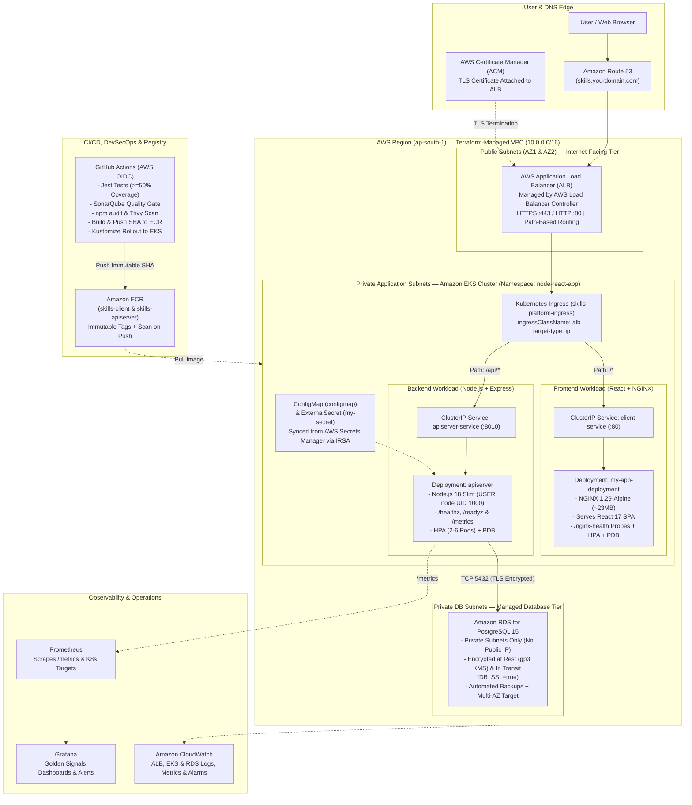
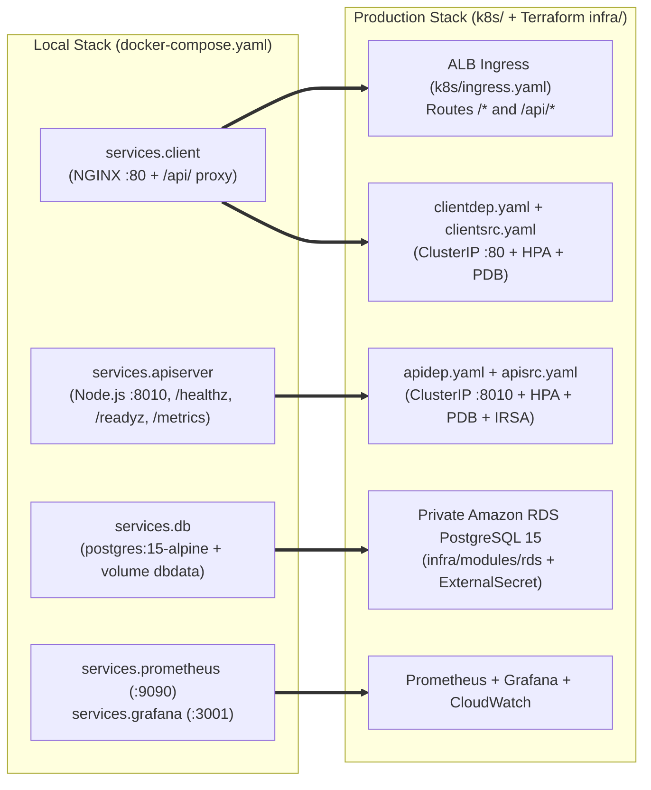

# Architecture Decision Record (ADR) & System Blueprint

> **Project:** Node.js Skills Management Platform — DevOps Portfolio Architecture  
> **Scope:** React + Node.js/Express + PostgreSQL on AWS EKS (`ap-south-1`) with Terraform IaC, ALB Ingress, Private RDS, CI/CD (OIDC), DevSecOps, and Prometheus/Grafana/CloudWatch  
> **Status:** Active Production Reference Blueprint

---

## 1. Executive System Overview

The platform is a cloud-native 3-tier web application built to manage professional skill portfolios. The production architecture decouples static frontend asset delivery (**React 17 + NGINX**), RESTful API services (**Node.js 18 + Express 4**), and relational persistence (**Private Amazon RDS for PostgreSQL 15**) across isolated VPC tiers managed declaratively via **Terraform** and **Kubernetes (Amazon EKS)**.

### Complete Production Architecture & Network Flow (`ap-south-1` Mumbai)

---

## 2. Architecture Decision Records (ADRs)

---

### ADR-001: Container Orchestration & Environment Parity (Docker Compose $\to$ Amazon EKS)

#### Context & Problem Statement
Engineers need a zero-cost, single-command local environment for daily development and debugging, while cloud deployments require multi-AZ scheduling, self-healing probes, Horizontal Pod Autoscaling (HPA), and zero-downtime rolling updates.

#### Decision
* **Local Development (`$0 Cost`)**: Use [`docker-compose.yaml`](file:///d:/javascript_project/node-react-postgres/docker-compose.yaml) with segmented bridge networks (`frontend-net`, `backend-net`, `monitoring-net`), a local `postgres:15-alpine` container, NGINX reverse proxy, Prometheus (`:9090`), and Grafana (`:3001`).
* **Cloud Deployment (`ap-south-1`)**: Use **Amazon EKS** with Kustomize overlays ([`k8s/overlays/lab`](file:///d:/javascript_project/node-react-postgres/k8s/overlays/lab/kustomization.yaml) and [`k8s/overlays/production`](file:///d:/javascript_project/node-react-postgres/k8s/overlays/production/kustomization.yaml)) backed by **Private Amazon RDS for PostgreSQL**.

#### Mapping Blueprint: Local Docker Compose $\to$ Production AWS EKS

---

### ADR-002: Edge Traffic Routing (Single AWS ALB Ingress vs. Multiple `LoadBalancer` Services)

#### Context & Problem Statement
ExposingKubernetes Services directly with `type: LoadBalancer` provisions a separate cloud load balancer per Service (~$16–$20/month base cost each) and lacks unified Layer 7 path-based routing or single-certificate HTTPS termination.

#### Decision
Expose both `client-service` (`:80`) and `apiserver-service` (`:8010`) as internal **`type: ClusterIP`** Services and route external traffic through a single **Kubernetes `Ingress`** ([`k8s/ingress.yaml`](file:///d:/javascript_project/node-react-postgres/k8s/ingress.yaml)) reconciled by the **AWS Load Balancer Controller** in `target-type: ip` mode:
* `/api/*` $\to$ `apiserver-service:8010`
* `/*` $\to$ `client-service:80`

| Dimension | Single ALB via Kubernetes Ingress (Selected) | `type: LoadBalancer` per Service |
| :--- | :--- | :--- |
| **AWS Cost** | **1 shared ALB** across all paths/services. | Separate LB billed per exposed service. |
| **Network Hop Efficiency** | `target-type: ip` routes directly from ALB to private Pod IPs. | Extra `NodePort` + `kube-proxy` hop across nodes. |
| **TLS & Security** | Central ACM HTTPS termination & optional AWS WAF attachment. | Requires managing TLS per load balancer or inside NGINX pods. |

---

### ADR-003: Database Tier (Private Amazon RDS PostgreSQL vs. In-Cluster Database Pod)

#### Decision
Migrate cloud persistence from an in-cluster PostgreSQL Pod (`dbdep.yaml` + `dbpvc.yaml`) to **Private Amazon RDS for PostgreSQL 15** ([`infra/modules/rds/main.tf`](file:///d:/javascript_project/node-react-postgres/infra/modules/rds/main.tf)) in isolated private DB subnets (`10.0.21.0/24`, `10.0.22.0/24`) with `publicly_accessible = false` and `DB_SSL=true`.
* **Lab Cost Control**: Uses `db.t4g.micro` (`multi_az = false`, `skip_final_snapshot = true`).
* **Production Target**: Enables synchronous `multi_az = true` standby failover and 7-day automated backups (Point-in-Time Recovery).

---

### ADR-004: Multi-Stage Non-Root Container Hardening

* **[`apiserver/Dockerfile`](file:///d:/javascript_project/node-react-postgres/apiserver/Dockerfile)**: 2-stage build (`node:18-bullseye-slim AS deps` running `npm ci --omit=dev` $\to$ `runtime` stage running as non-root `USER node` UID 1000 with native `/healthz` `HEALTHCHECK`).
* **[`client/Dockerfile`](file:///d:/javascript_project/node-react-postgres/client/Dockerfile)**: 2-stage build (`node:18-bullseye-slim AS Builder` $\to$ `nginx:1.29-alpine` ~23MB runtime with `/nginx-health` `HEALTHCHECK`).
* **[`apiserver/.dockerignore`](file:///d:/javascript_project/node-react-postgres/apiserver/.dockerignore)**: Strictly blocks `.config.env`, `*.env`, `coverage/`, and test files from entering image layers.

---

### ADR-005: Passwordless CI/CD with GitHub OIDC & Automated Rollback

* **CI ([`.github/workflows/main.yaml`](file:///d:/javascript_project/node-react-postgres/.github/workflows/main.yaml))**: Enforces parallel Jest unit/integration tests (`>=50%` coverage across statements, branches, functions, and lines), SonarQube quality gate, `npm audit`, multi-stage Docker build validation, and Trivy filesystem/secret/image CVE scanning.
* **CD ([`.github/workflows/deploy-lab.yml`](file:///d:/javascript_project/node-react-postgres/.github/workflows/deploy-lab.yml))**: Uses **GitHub OIDC (`sts:AssumeRoleWithWebIdentity`)** ([`infra/modules/iam/main.tf`](file:///d:/javascript_project/node-react-postgres/infra/modules/iam/main.tf)) with zero long-lived AWS keys, pushes immutable Git SHA images to ECR, deploys via Kustomize, verifies rollout status, and automatically runs `kubectl rollout undo` if readiness probes fail.
