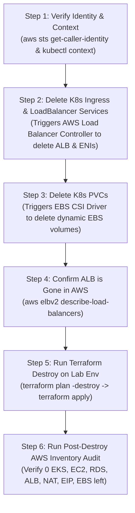

# AWS_COST_OPTIMIZATION_AND_CLEANUP.md
## AWS Cost Control, Safe Workload Shutdown & Dependency-Ordered Teardown Guide (Hinglish)

> **Default Region:** `ap-south-1` (AWS Mumbai)  
> **Project:** Node.js Skills Management Platform (`node-react-postgres`)  
> **Companion Manual:** [DEVOPS_IMPLEMENTATION_GUIDE.md](./DEVOPS_IMPLEMENTATION_GUIDE.md)

---

## ⚠️ Golden FinOps Rule Before Creating Any AWS Resource

Cloud resources (khaaskar **EKS Control Plane, EC2 Worker Nodes, NAT Gateway, Application Load Balancer, aur RDS**) **per-hour / per-second** charge karte hain, chahe aapकी website par **zero traffic** ho!
* **Rule #1**: Local learning (Phase 0 se Phase 4: Node.js, Docker, Docker Compose, NGINX, Prometheus, Grafana) **100% locally** karein (**Cost: \$0.00**).
* **Rule #2**: AWS stack (`infra/envs/lab`) sirf tab provision karein jab aap cloud hands-on lab (2–4 hours) kar rahe hon, aur session khatam hote hi **Operation C (Complete Teardown)** chala kar verify karein.
* **Rule #3**: Pehle din **AWS Budgets** mein ek \$5.00 aur \$10.00 ka email alert set karein. *(Dhyaan rahe: AWS Budget sirf notification/email bhejta hai, woh aapke running servers ko apne aap stop ya delete NAHI karta!)*

---

## 1. AWS Mumbai (`ap-south-1`) Resource Cost Matrix (What Bills & Why)

Jab aapka lab stack running hota hai vs jab aap compute pause karte ho, tab kaun sa resource kitna charge karta hai:

| AWS Resource | Approx Rate in `ap-south-1` (Estimate Only) | Bills When Running? | Bills When Stopped / Idle? | Cost-Saving Lab Tip |
| :--- | :--- | :--- | :--- | :--- |
| **Amazon EKS Control Plane** | ~\$0.10 / hour (~\$73 / month) | ✅ YES | ✅ **YES (Cannot be "stopped"!)** | EKS cluster ko overnight chalu mat chhodein; destroy after lab session. |
| **EC2 Worker Nodes (Managed Node Group)** | ~\$0.023–\$0.046 / hr per node (`t3.small`/`t3.medium`) | ✅ YES | ❌ Compute stops if Node Group scaled to `0`, **but EBS root volumes still bill** | Lab mein 1–2 small nodes ya Spot instances use karein. |
| **NAT Gateway** | ~\$0.045–\$0.056 / hour + per GB data processed | ✅ YES | ✅ **YES (Charges hourly even with 0 traffic!)** | Production mein 2 NAT GW (1 per AZ) lagte hain; Lab mein `single_nat_gateway = true` rakhein. |
| **Application Load Balancer (ALB)** | ~\$0.0225–\$0.025 / hour + LCU charges | ✅ YES | ✅ **YES (Charges hourly as long as Ingress/LB exists)** | `type: LoadBalancer` Services ke bajay 1 shared ALB Ingress use karein. |
| **Elastic IP (EIP)** | ~\$0.005 / hour (~\$3.60 / month per IP) | ✅ YES | ✅ **YES (Even if unattached!)** | Destroy ke baad unattached EIPs (`describe-addresses`) zaroor check karein. |
| **Amazon RDS PostgreSQL** | ~\$0.018–\$0.036 / hr (`db.t4g.micro` Single-AZ) + Storage | ✅ YES | ⚠️ Compute stops for **up to 7 days** if stopped; **Storage & Snapshots STILL BILL** | Lab mein `multi_az = false` aur `skip_final_snapshot = true` rakhein. |
| **Amazon EBS Volumes (`gp3`)** | ~\$0.08–\$0.095 per GB-month | ✅ YES | ✅ **YES (Bills until volume is deleted)** | Delete `PVC`s before destroying EKS so EBS CSI cleans up volumes. |
| **RDS Snapshots & EBS Snapshots** | ~\$0.05–\$0.095 per GB-month | ✅ YES | ✅ **YES (Survives `terraform destroy` if retained!)** | Manual aur final snapshots check karke delete karein agar data nahi chahiye. |
| **Amazon ECR** | ~\$0.10 per GB-month (Free tier: 500MB for 1st yr) | ✅ YES | ✅ YES (Per GB stored) | Lifecycle policy lagayein jo purane untagged images auto-delete kare. |
| **Amazon S3 (`tfstate` bucket)** | ~\$0.023 per GB-month (< \$0.01/month for state file) | ✅ YES | ✅ YES (Pennies per month) | State bucket ko retain karein; iska kharcha negligible (< 1 cent) hota hai. |
| **CloudWatch Logs & Alarms** | Free tier covers 5GB logs & 10 alarms; then per GB/alarm | ✅ YES | ✅ YES (Log storage retention) | Lab mein log retention `7 days` (`retention_in_days = 7`) set karein, `Never Expire` nahi! |

*(Note: Exact prices region aur AWS updates ke hisaab se badal sakte hain; hamesha [AWS Pricing Calculator](https://calculator.aws/) check karein.)*

---

## Operation A — Stop Local Containers Without Deleting PostgreSQL Data

### Kab Use Karein?
Jab aap apne laptop par (`docker-compose.yaml`) kaam kar rahe ho aur laptop ka RAM/CPU free karna chahte ho, lekin **PostgreSQL database (`sampledb`) ke andar banaye hue users aur skills data ko safe rakhna chahte ho**.

### Step-by-Step Commands (`d:\javascript_project\node-react-postgres`)

#### Option A1: Sirf Containers Pause/Stop Karna (Fastest Resume)
```powershell
# 1. Check currently running containers
docker compose ps

# 2. Stop running containers without removing containers, networks, or volumes
docker compose stop

# 3. Verify containers are stopped (Exited) and volume still exists
docker compose ps -a
docker volume ls | Select-String "dbdata"
```
* **Wapas Start Karne Ke Liye**: `docker compose start` (2 seconds mein wahi containers aur DB data wapas chalu ho jayenge).

#### Option A2: Containers & Networks Remove Karna Par DB Volume Safe Rakhna
```powershell
# Removes containers and virtual networks, but PRESERVES named volume 'dbdata'
docker compose down

# Verify your PostgreSQL volume is still intact
docker volume inspect node-react-postgres_dbdata
```

> [!CAUTION]
> **Data Loss Warning (`docker compose down -v`)**:
> Kabhi bhi `docker compose down -v` (with `-v` / `--volumes` flag) mat chalana jab tak aap **jaan-boojh kar (intentionally)** local database ko poora wipe/reset nahi karna chahte! `-v` flag `dbdata` named volume ko permanently delete kar deta hai.

---

## Operation B — Temporarily Shut Down Suitable AWS Workloads (Pause Mode)

### Kab Use Karein?
Maano aap दोपहर (afternoon) mein lab kar rahe ho aur 3–4 ghante ka break le rahe ho, aur aap poora EKS cluster (`15–20 mins` creation time) destroy nahi karna chahte, balki sirf compute cost (`EC2` + `RDS instance`) kam karna chahte ho.

> [!WARNING]
> **Critical Billing Reality Check for Operation B**:
> AWS mein **EKS Control Plane (\$0.10/hr)**, **NAT Gateway (~\$0.045/hr)**, aur **ALB (~\$0.0225/hr)** ko "Stop/Pause" karne ka koi button **NAHI** hota!
> Agar aap Operation B use karte ho, toh aapka EC2 aur RDS compute ruk jayega, lekin **EKS Control Plane + NAT Gateway + ALB + EBS/RDS Storage ka meter chalta rahega (~\$0.17/hour ya ~\$4.00/day)**.
> Isliye **रात bhar (overnight) ya 1 din se zyada** ke break ke liye Operation B **MAT** use karein—seedha **Operation C (Complete Teardown)** use karein!

### Step-by-Step Commands for Temporary AWS Workload Pause

```powershell
# 1. Verify AWS Account and Kubernetes Context
aws sts get-caller-identity
kubectl config current-context

# 2. Scale Kubernetes application Deployments down to 0 replicas
kubectl scale deployment apiserver my-app-deployment -n node-react-app --replicas=0
kubectl get pods -n node-react-app

# 3. Scale EKS Managed Node Group to 0 worker nodes (stops EC2 instance billing)
aws eks update-nodegroup-config `
  --cluster-name skills-lab-eks `
  --nodegroup-name skills-lab-node-group `
  --scaling-config minSize=0,maxSize=2,desiredSize=0 `
  --region ap-south-1

# 4. Stop Single-AZ RDS Instance (pauses RDS compute billing for up to 7 days)
# Note: AWS automatically restarts a stopped RDS instance after 7 days!
aws rds stop-db-instance `
  --db-instance-identifier skills-lab-postgres `
  --region ap-south-1
```

### How to Resume from Operation B
```powershell
# 1. Start RDS Instance first and wait until 'available'
aws rds start-db-instance --db-instance-identifier skills-lab-postgres --region ap-south-1
aws rds wait db-instance-available --db-instance-identifier skills-lab-postgres --region ap-south-1

# 2. Scale EKS Node Group back to desiredSize=2
aws eks update-nodegroup-config `
  --cluster-name skills-lab-eks `
  --nodegroup-name skills-lab-node-group `
  --scaling-config minSize=1,maxSize=3,desiredSize=2 `
  --region ap-south-1

# 3. Wait for nodes to become Ready, then scale Deployments back up
kubectl get nodes -w
kubectl scale deployment apiserver my-app-deployment -n node-react-app --replicas=2
```

---

## Operation C — Complete Lab Infrastructure Teardown (Safe Dependency Order)

### Why Dependency Order Matters (Why Raw `terraform destroy` Often Hangs or Fails!)
Bohot saare beginners seedha `terraform destroy` chala dete hain, aur Terraform 20 minute baad **`DependencyViolation: The vpc 'vpc-xxx' has dependencies and cannot be deleted`** dekar अटक (hang) jata hai!
**Reason (Interview Gold)**:
1. Jab aap Kubernetes mein `Ingress` (AWS Load Balancer Controller) ya `Service (type: LoadBalancer)` banate ho, toh **Kubernetes Controller** AWS mein ek **Application Load Balancer (ALB)**, **Target Groups**, **Security Group Rules**, aur Public Subnets mein **Elastic Network Interfaces (ENIs)** banata hai.
2. Terraform ko un Kubernetes-created ALB aur ENIs ke baare mein **pata nahi hota** (kyunki wo `terraform.tfstate` ke bahar Kubernetes ne banaye hain — this is a classic example of external resource dependency!).
3. Agar aap pehle Kubernetes `Ingress` / `LoadBalancer` Service aur `PVC` delete nahi karoge, toh ALB ke ENIs VPC subnets ko lock karke rakhenge aur Terraform VPC/Subnets delete nahi kar payega!



### Step-by-Step Commands for Operation C (Execute Only After Explicit Approval)

#### Step 1: Pre-Destroy Verification (Account, Region, Context & Data Backup Decision)
```powershell
# Confirm you are in the LAB account and ap-south-1 region (NEVER run on production!)
aws sts get-caller-identity
aws configure get region
kubectl config current-context
```
* **Data Loss Check**: `terraform destroy` chalane se RDS database (`skills-lab-postgres`) aur uska saara data permanently delete ho jayega (agar `skip_final_snapshot = true` hai). Agar aapko final snapshot rakhna hai toh dhyaan rahe ki snapshot storage charge karta rahega.

#### Step 2: Remove Kubernetes Controller-Managed AWS Resources FIRST
```powershell
# 1. Delete Ingress (so AWS Load Balancer Controller deletes the AWS ALB and Target Groups)
kubectl delete ingress --all -n node-react-app --ignore-not-found=true

# 2. Delete any Service of type LoadBalancer (if present)
kubectl delete svc client-service -n node-react-app --ignore-not-found=true

# 3. Delete PersistentVolumeClaims (so EBS CSI driver deletes dynamic gp3 EBS volumes)
kubectl delete pvc --all -n node-react-app --ignore-not-found=true

# 4. Wait 60-90 seconds and verify the ALB is completely removed in AWS
aws elbv2 describe-load-balancers --region ap-south-1 --query "LoadBalancers[*].[LoadBalancerName,State.Code,VpcId]" --output table
```

#### Step 3: Destroy Terraform-Managed Lab Stack (`infra/envs/lab`)
```powershell
# 1. Generate and review the destroy plan first
terraform -chdir=infra/envs/lab plan -destroy -out=tfdestroy.plan

# 2. Inspect exactly what will be destroyed
terraform -chdir=infra/envs/lab show tfdestroy.plan

# 3. Execute destroy ONLY after reviewing the plan
terraform -chdir=infra/envs/lab apply tfdestroy.plan
```

#### Step 4: Preserve Remote State Backend (`infra/bootstrap`)
* **Do NOT destroy `infra/bootstrap` (the S3 state bucket)** after normal lab sessions!
* Empty `terraform.tfstate` file S3 mein rakhne ka kharcha **\$0.00–\$0.01/month** hota hai, aur isse aap agle din ek single command (`terraform apply`) se poora lab dubara khada kar sakte ho.
* **Retiring the Backend Bucket (Only when permanently archiving the project)**:
  1. Ensure `infra/envs/lab` state has `0` resources (`terraform -chdir=infra/envs/lab state list`).
  2. Empty all S3 object versions and delete markers from the state bucket.
  3. Run `terraform -chdir=infra/bootstrap destroy`.

---

## 2. Mandatory Post-Destroy AWS Inventory Audit (`ap-south-1`)

`terraform destroy` successful dikhane ke baad bhi **kabhi aankh band karke bharosa mat karein**. Niche diye gaye **11 AWS CLI verification commands** chala kar confirm karein ki koi orphan resource bill nahi bana raha:

```powershell
# 1. Check EKS Clusters (Expected: empty list [])
aws eks list-clusters --region ap-south-1

# 2. Check Running or Stopped EC2 Instances (Expected: empty)
aws ec2 describe-instances --region ap-south-1 `
  --filters "Name=instance-state-name,Values=pending,running,stopping,stopped" `
  --query "Reservations[*].Instances[*].[InstanceId,InstanceType,State.Name,Tags[?Key=='Name']|[0].Value]" `
  --output table

# 3. Check Application / Network Load Balancers (Expected: empty)
aws elbv2 describe-load-balancers --region ap-south-1 `
  --query "LoadBalancers[*].[LoadBalancerName,Type,State.Code]" --output table

# 4. Check Classic Load Balancers (Expected: empty — created if Service type: LoadBalancer was used without annotations)
aws elb describe-load-balancers --region ap-south-1 `
  --query "LoadBalancerDescriptions[*].LoadBalancerName" --output table

# 5. Check NAT Gateways (Expected: empty or State='deleted')
aws ec2 describe-nat-gateways --region ap-south-1 `
  --filter "Name=state,Values=pending,available,deleting" `
  --query "NatGateways[*].[NatGatewayId,State,SubnetId]" --output table

# 6. Check Elastic IPs (CRITICAL: Unattached EIPs charge $0.005/hr!)
aws ec2 describe-addresses --region ap-south-1 `
  --query "Addresses[*].[PublicIp,AllocationId,AssociationId]" --output table

# 7. Check RDS Database Instances (Expected: empty)
aws rds describe-db-instances --region ap-south-1 `
  --query "DBInstances[*].[DBInstanceIdentifier,DBInstanceClass,DBInstanceStatus]" --output table

# 8. Check Retained RDS Manual/Final Snapshots (Charge per GB-month if left behind!)
aws rds describe-db-snapshots --region ap-south-1 --snapshot-type manual `
  --query "DBSnapshots[*].[DBSnapshotIdentifier,AllocatedStorage,Status]" --output table

# 9. Check Unattached / Available EBS Volumes (Left behind if PVCs weren't deleted cleanly)
aws ec2 describe-volumes --region ap-south-1 `
  --filters "Name=status,Values=available,in-use" `
  --query "Volumes[*].[VolumeId,Size,State,VolumeType]" --output table

# 10. Check ECR Repositories & Image Storage
aws ecr describe-repositories --region ap-south-1 `
  --query "repositories[*].[repositoryName,repositoryUri]" --output table

# 11. Check CloudWatch Log Groups & Retention Policy
aws logs describe-log-groups --region ap-south-1 `
  --query "logGroups[*].[logGroupName,retentionInDays,storedBytes]" --output table
```

---

## 3. Important Operational Concepts to Explain in Interviews

1. **Delayed AWS Billing Reports**:
   * AWS Cost Explorer aur Billing Dashboard real-time nahi hote; usage data aane mein **8 se 24 ghante ka delay** hota hai. Isliye `terraform destroy` ke baad billing confirm karne ka sahi tarika **Active Resource Inventory Check (above 11 CLI commands)** hai, na ki sirf Billing page refresh karna.
2. **Terraform Drift & Orphaned Resources**:
   * Agar kisi ne AWS Console se manually ek Security Group rule ya EC2 instance add kar diya aur usse EKS VPC mein attach kar diya, toh woh Terraform state mein nahi hoga (**Terraform Drift**). Destroy ke waqt woh manual resource VPC deletion ko block karega.
3. **Retained Snapshots vs. Zero Bill**:
   * Jab RDS delete hota hai aur `skip_final_snapshot = false` hota hai, toh RDS compute ruk jata hai par final snapshot S3/RDS backup storage mein rehta hai aur हर mahine per-GB charge karta hai.
