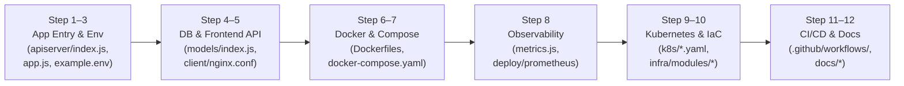

# HOW TO READ, UNDERSTAND & IMPLEMENT THIS ENTIRE PROJECT (Fresher to Senior DevOps Engineer Guide)

> **File Location:** `HOW_TO_READ_AND_MASTER_THIS_PROJECT.md`  
> **Target Audience:** Fresher / Beginner starting from zero who wants to read, understand, build, test, troubleshoot, and explain this entire repository like a **Senior (3+ Years) DevOps Engineer**.  
> **Golden Rule:** Is guide mein aapko **1) Kis file ko kis order mein padhna hai**, **2) Har file ka poora code aur line-by-line matlab**, aur **3) Apne haath se terminal par chalane ke liye exact step-by-step commands** diye gaye hain.

---

## 📑 Table of Contents

1. [Part 1: How a DevOps Engineer Reads a New Repository (The 12-Step Reading Order)](#part-1-how-a-devops-engineer-reads-a-new-repository-the-12-step-reading-order)
2. [Part 2: Master Architecture, Ports & Environment Variables Map](#part-2-master-architecture-ports--environment-variables-map)
3. [Part 3: Step-by-Step Self-Implementation Roadmap (Fresher $\to$ Senior)](#part-3-step-by-step-self-implementation-roadmap-fresher--senior)
   - [Milestone 1 (Fresher): Understand the App, Health Probes & Run Automated Tests](#milestone-1-fresher-understand-the-app-health-probes--run-automated-tests)
   - [Milestone 2 (Junior DevOps): Write & Build Production Multi-Stage Dockerfiles](#milestone-2-junior-devops-write--build-production-multi-stage-dockerfiles)
   - [Milestone 3 (Junior-to-Mid DevOps): Orchestrate Docker Compose, NGINX Reverse Proxy & Prometheus/Grafana](#milestone-3-junior-to-mid-devops-orchestrate-docker-compose-nginx-reverse-proxy--prometheusgrafana)
   - [Milestone 4 (Intermediate DevOps): Implement Kubernetes Manifests & Kustomize Overlays (`k8s/`)](#milestone-4-intermediate-devops-implement-kubernetes-manifests--kustomize-overlays-k8s)
   - [Milestone 5 (Senior DevOps): Build Modular Terraform Infrastructure as Code (`infra/`)](#milestone-5-senior-devops-build-modular-terraform-infrastructure-as-code-infra)
   - [Milestone 6 (Senior DevSecOps): Implement GitHub Actions CI/CD with AWS OIDC, SonarQube & Trivy](#milestone-6-senior-devsecops-implement-github-actions-cicd-with-aws-oidc-sonarqube--trivy)
   - [Milestone 7 (Senior SRE / Troubleshooter): 6 Hands-On "Break-and-Fix" Drills to Run on Your Laptop](#milestone-7-senior-sre--troubleshooter-6-hands-on-break-and-fix-drills-to-run-on-your-laptop)
   - [Milestone 8 (FinOps & Cleanup): Safe Shutdown & Zero-Bill Verification](#milestone-8-finops--cleanup-safe-shutdown--zero-bill-verification)
4. [Part 4: Complete Reference Guide Index in This Repository](#part-4-complete-reference-guide-index-in-this-repository)

---

## Part 1: How a DevOps Engineer Reads a New Repository (The 12-Step Reading Order)

Jab ek **Fresher** kisi bade project ko dekhta hai, toh woh galti se seedha `k8s/` ya `infra/` (Terraform) khol leta hai aur confuse ho jata hai ki `"8010 port kahan se aaya? DB_SSL kya hai? my-secret mein kaunse keys chahiye?"`

Ek **Senior DevOps Engineer** hamesha **Inside-Out Order (Application $\to$ Container $\to$ Local Stack $\to$ Kubernetes $\to$ Cloud IaC $\to$ CI/CD)** mein project padhta hai. Aap bilkul niche diye gaye **Step 1 se Step 12** ke order mein files open karke padhein:



### Exact File-by-File Reading Sequence

| Reading Step | File to Open | What You Must Look For Inside This File (Hinglish Guide) |
| :--- | :--- | :--- |
| **Step 1** | [`apiserver/package.json`](./apiserver/package.json) & [`client/package.json`](./client/package.json) | Sabse pehle dekhein ki Node.js backend aur React frontend mein kaunse libraries aur test scripts (`npm test`, `npm run build`) hain. |
| **Step 2** | [`apiserver/example.env`](./apiserver/example.env) & [`apiserver/config/index.js`](./apiserver/config/index.js) | Dekhein ki backend ko chalne ke liye kaun-kaun se **Environment Variables** (`PORT=8010`, `DB_HOST`, `DB_USER`, `DB_PASS`, `DB_NAME`, `DB_SSL`, `JWT_*`, `SESSION_*`) chahiye. Yahi variables aage Docker Compose, Kubernetes `ConfigMap`/`Secret`, aur AWS Secrets Manager mein jayenge! |
| **Step 3** | [`apiserver/index.js`](./apiserver/index.js) & [`apiserver/app.js`](./apiserver/app.js) | Dekhein server start kaise hota hai (`app.listen(PORT)`), database sync kaise hota hai (`sampledb.sync()`), `SIGTERM` graceful shutdown kaise kaam karta hai, aur DevOps endpoints (`/healthz`, `/readyz`, `/metrics`) kaise likhe gaye hain. |
| **Step 4** | [`apiserver/models/index.js`](./apiserver/models/index.js) | Dekhein backend PostgreSQL se kaise connect hota hai (`Sequelize`), connection pool (`max: 5`) kya hai, aur `DB_SSL === 'true'` hone par Amazon RDS ke liye TLS encryption kaise on hota hai. |
| **Step 5** | [`client/src/services/authService.js`](./client/src/services/authService.js) & [`client/nginx.conf`](./client/nginx.conf) | Dekhein ki React frontend `/api/v1/auth/login` par request bhejta hai, aur NGINX port `80` par React ki HTML files serve karta hai jabki `/api/` wali requests ko `proxy_pass http://apiserver:8010;` ke through backend par bhej deta hai. |
| **Step 6** | [`apiserver/.dockerignore`](./apiserver/.dockerignore), [`apiserver/Dockerfile`](./apiserver/Dockerfile), [`client/Dockerfile`](./client/Dockerfile) | Dekhein kaise dono services ko **2-Stage Multi-Stage Dockerfiles** se package kiya gaya hai, `.config.env` ko `.dockerignore` se block kiya gaya hai, aur `USER node` (non-root UID 1000) + `HEALTHCHECK` lagaya gaya hai. |
| **Step 7** | [`docker-compose.yaml`](./docker-compose.yaml) | Dekhein kaise local laptop par 5 containers (`db`, `apiserver`, `client`, `prometheus`, `grafana`) 3 isolated networks (`frontend-net`, `backend-net`, `monitoring-net`) aur `service_healthy` checks ke saath ek saath chalte hain. |
| **Step 8** | [`apiserver/metrics.js`](./apiserver/metrics.js) & [`deploy/prometheus/prometheus.yml`](./deploy/prometheus/prometheus.yml) | Dekhein kaise `apiserver` `/metrics` expose karta hai, Prometheus har 15 second mein use scrape karta hai, `deploy/prometheus/alerts.yml` alerts check karta hai, aur Grafana (`deploy/grafana/dashboards/node-api.json`) graphs dikhata hai. |
| **Step 9** | [`k8s/`](./k8s/kustomization.yaml) & [`k8s/overlays/`](./k8s/overlays/lab/kustomization.yaml) | Is order mein K8s files padhein: `namespace.yaml` $\to$ `configmap.yaml` $\to$ `secret.yaml` / `external-secret.yaml` $\to$ `apidep.yaml` $\to$ `apisrc.yaml` $\to$ `clientdep.yaml` $\to$ `clientsrc.yaml` $\to$ `ingress.yaml` $\to$ `hpa.yaml` $\to$ `pdb.yaml` $\to$ `overlays/{lab,production}/kustomization.yaml`. |
| **Step 10** | [`infra/bootstrap/main.tf`](./infra/bootstrap/main.tf), [`infra/modules/*`](./infra/modules/network/main.tf), [`infra/envs/lab/main.tf`](./infra/envs/lab/main.tf) | Dekhein kaise Terraform AWS Mumbai (`ap-south-1`) mein S3 state bucket, 3-Tier VPC (`10.0.0.0/16`), ECR, EKS Cluster, Private RDS PostgreSQL, Secrets Manager, aur GitHub OIDC IAM Role banata hai. |
| **Step 11** | [`.github/workflows/main.yaml`](./.github/workflows/main.yaml) & [`.github/workflows/deploy-lab.yml`](./.github/workflows/deploy-lab.yml) | Dekhein kaise CI pipeline har commit par Jest tests, SonarQube, `npm audit`, aur Trivy scans chalata hai, aur CD pipeline AWS OIDC se authenticate hokar EKS par rollout + auto-rollback karta hai. |
| **Step 12** | [`docs/devops-interview-preparation/`](./docs/devops-interview-preparation/00-LEARNING-ROADMAP.md) | Jab aapko code aur infra samajh aa jaye, tab `00-LEARNING-ROADMAP.md` se lekar `15-AWS-COST-OPTIMIZATION-AND-CLEANUP.md` (aur 60 scenarios in `11-REAL-WORLD-SCENARIO-QUESTIONS.md`) padh kar interview practice karein. |

---

## Part 2: Master Architecture, Ports & Environment Variables Map

Project mein kaam karte waqt is table ko apne saamne rakhein taaki aapko kabhi port ya service name ka confusion na ho:

| Component | Folder | Local Dev Port | Docker Compose Service & Port | Kubernetes Service & Port (`namespace: node-react-app`) | Health / Metrics Endpoint |
| :--- | :--- | :--- | :--- | :--- | :--- |
| **Frontend (React + NGINX)** | `client/` | `3000` (React Dev) | `client:80` (Host `localhost:80`) | `client-service:80` (`ClusterIP`, Deployment: `my-app-deployment`) | `GET /nginx-health` (`200 healthy`) |
| **Backend API (Node/Express)** | `apiserver/` | `8010` | `apiserver:8010` (Host `localhost:8010`) | `apiserver-service:8010` & alias `apiserver:8010` (`ClusterIP`, Deployment: `apiserver`) | `GET /healthz` (Liveness)<br>`GET /readyz` (Readiness)<br>`GET /metrics` (Prometheus) |
| **Database (PostgreSQL 15)** | `apiserver/models/` | `5432` | `db:5432` (Volume: `dbdata`) | Local K8s: `postgres-service:5432`<br>AWS EKS: Private RDS (`skills-lab-postgres...:5432`) | `pg_isready -U postgres -d sampledb` |
| **Prometheus Server** | `deploy/prometheus/` | N/A | `prometheus:9090` (Host `localhost:9090`) | Scrapes `apiserver:8010/metrics` via Pod annotations | `http://localhost:9090/targets` |
| **Grafana Dashboards** | `deploy/grafana/` | N/A | `grafana:3000` (Host `localhost:3001`) | Visualizes Golden Signals (RPS, p95 Latency, 5xx, Memory) | `http://localhost:3001` (`admin` / `adminpassword`) |

---

## Part 3: Step-by-Step Self-Implementation Roadmap (Fresher $\to$ Senior)

Ab aap khud ek-ek Milestone apne terminal (`PowerShell` ya `Bash`) mein execute karke har file aur command ko practically seekhenge.

---

### Milestone 1 (Fresher): Understand the App, Health Probes & Run Automated Tests

#### 1.1 Why DevOps Needs `/healthz`, `/readyz`, and `/metrics` (`apiserver/app.js`)
Developer sirf `/api/v1/auth` aur `/api/v1/skills` banata hai. DevOps Engineer ko Kubernetes aur Load Balancer ke liye 3 endpoints chahiye hote hain:
1. **`GET /healthz` (Liveness Probe)**: Bina database query kiye check karta hai ki Node.js process zinda hai ya hang ho gaya hai.
2. **`GET /readyz` (Readiness Probe)**: `await sampledb.authenticate()` chala kar check karta hai ki PostgreSQL connected hai ya nahi. Agar DB down hai toh `503` return karta hai taaki Kubernetes us Pod par user traffic na bheje.
3. **`GET /metrics` (Prometheus Telemetry)**: Request count, latency histogram, aur RAM/CPU usage return karta hai.

#### 1.2 Exact Code in [`apiserver/app.js`](./apiserver/app.js) (Lines 28–55)
```javascript
// Prometheus HTTP request duration & counter middleware
app.use(metricsMiddleware)

// Operational Health & Readiness Probes (Phase 1 DevOps Endpoints)
app.get('/healthz', (req, res) => {
    res.status(200).json({
        status: 'ok',
        service: 'apiserver',
        uptime: process.uptime(),
        timestamp: new Date().toISOString()
    })
})

app.get('/readyz', async (req, res) => {
    try {
        await sampledb.authenticate()
        res.status(200).json({
            status: 'ready',
            database: 'connected',
            timestamp: new Date().toISOString()
        })
    } catch (err) {
        res.status(503).json({
            status: 'not_ready',
            database: 'disconnected',
            message: err.message
        })
    }
})

// Prometheus Metrics Endpoint (Phase 4 Observability)
app.get('/metrics', metricsEndpoint)
```

#### 1.3 Exact Code for RDS SSL/TLS Toggle in [`apiserver/models/index.js`](./apiserver/models/index.js)
```javascript
const useSsl = process.env.DB_SSL === 'true';

const sampledb = new Sequelize(
    process.env.DB_NAME,
    process.env.DB_USER,
    process.env.DB_PASS,
    {
        host: process.env.DB_HOST,
        port: Number(process.env.DB_PORT) || 5432,
        dialect: 'postgres',
        logging: false,
        dialectOptions: useSsl
            ? {
                  ssl: {
                      require: true,
                      rejectUnauthorized: false,
                  },
              }
            : {},
        pool: {
            max: 5,
            min: 0,
            acquire: 30000,
            idle: 10000
        }
    }
);
```

#### 1.4 Hands-On Commands You Should Run Yourself Now
```powershell
# 1. Go to project root
cd d:\javascript_project\node-react-postgres

# 2. Create your local environment config from example.env (if not already present)
Copy-Item apiserver/example.env apiserver/.config.env

# 3. Run Backend Unit & Integration Tests (53 tests across 8 suites + >=50% coverage check)
npm --prefix apiserver test -- --coverage

# 4. Run Frontend React Unit Tests (19 tests across 9 suites)
npm --prefix client test -- --watchAll=false
```

---

### Milestone 2 (Junior DevOps): Write & Build Production Multi-Stage Dockerfiles

#### 2.1 Backend Dockerfile ([`apiserver/Dockerfile`](./apiserver/Dockerfile)) — Complete Code & Explanation
```dockerfile
# Stage 1: Deterministic Production Dependencies
FROM node:18-alpine AS deps
WORKDIR /app
COPY package*.json ./
RUN npm ci --omit=dev && npm cache clean --force

# Stage 2: Hardened Non-Root Runtime Image
FROM node:18-alpine AS runtime
WORKDIR /app

ENV NODE_ENV=production
ENV PORT=8010

# Copy production node_modules from deps stage
COPY --from=deps /app/node_modules ./node_modules

# Copy application source (filtered by apiserver/.dockerignore)
COPY . .

# Ensure upload directory exists and is owned by non-root 'node' user (UID 1000)
RUN mkdir -p /app/images/profile && chown -R node:node /app

USER node

EXPOSE 8010

HEALTHCHECK --interval=30s --timeout=5s --start-period=15s --retries=3 \
  CMD node -e "require('http').get('http://127.0.0.1:8010/healthz', (r) => process.exit(r.statusCode === 200 ? 0 : 1)).on('error', () => process.exit(1))"

CMD ["node", "index.js"]
```
- **Why `npm ci --omit=dev`?**: `jest`, `supertest`, aur `@babel/*` ko production image mein jane se rokta hai (image chhoti banti hai aur attack surface kam hota hai).
- **Why `chown -R node:node /app` & `USER node`?**: Container root (`UID 0`) ke bajaye `UID 1000` par chalta hai, aur `/app/images/profile` writable rehta hai.

#### 2.2 Frontend NGINX Config ([`client/nginx.conf`](./client/nginx.conf)) & Dockerfile ([`client/Dockerfile`](./client/Dockerfile))
```nginx
server {
    listen 80;
    root /usr/share/nginx/html;
    index index.html;

    location = /nginx-health {
        access_log off;
        return 200 "healthy\n";
        add_header Content-Type text/plain;
    }

    location / {
        try_files $uri $uri/ /index.html;
    }

    location /api/ {
        proxy_pass http://apiserver:8010;
        proxy_http_version 1.1;
        proxy_set_header Host $host;
        proxy_set_header X-Real-IP $remote_addr;
        proxy_set_header X-Forwarded-For $proxy_add_x_forwarded_for;
        proxy_set_header X-Forwarded-Proto $scheme;
    }
}
```
> **Important Interview Point**: Line 17 mein `proxy_pass http://apiserver:8010;` ke aage `/` (trailing slash) **nahi** lagana hai! Agar `http://apiserver:8010/;` laga diya, toh NGINX `/api/` prefix kaat dega aur backend ko `/v1/auth/login` milega jo `404` dega.

```dockerfile
# Stage 1: Compile React Production Bundle
FROM node:18-alpine AS build
WORKDIR /app
COPY package*.json ./
RUN npm ci
COPY . .
RUN npm run build

# Stage 2: Serve Static Assets & Reverse Proxy via NGINX
FROM nginx:1.27-alpine AS runtime
COPY --from=build /app/build /usr/share/nginx/html
COPY nginx.conf /etc/nginx/conf.d/default.conf

EXPOSE 80

HEALTHCHECK --interval=30s --timeout=5s --start-period=10s --retries=3 \
  CMD wget -qO- http://127.0.0.1:80/nginx-health || exit 1

CMD ["nginx", "-g", "daemon off;"]
```

#### 2.3 Hands-On Commands You Should Run Yourself Now
```powershell
# 1. Build both production images locally
docker build -t skills-apiserver:local ./apiserver
docker build -t skills-client:local ./client

# 2. Check image sizes (notice client is ~45MB because Node/node_modules were discarded in Stage 1!)
docker images | Select-String "skills-"

# 3. Verify that apiserver runs as non-root user 'node' (uid=1000) and NOT root (uid=0)
docker run --rm skills-apiserver:local id

# 4. Verify that .config.env was NOT leaked inside the apiserver image
docker run --rm skills-apiserver:local ls -la /app
```

---

### Milestone 3 (Junior-to-Mid DevOps): Orchestrate Docker Compose, NGINX Reverse Proxy & Prometheus/Grafana

#### 3.1 How [`docker-compose.yaml`](./docker-compose.yaml) Connects 5 Containers Across 3 Networks
Open [`docker-compose.yaml`](./docker-compose.yaml) and observe:
- **`backend-net`**: Connects `apiserver` $\leftrightarrow$ `db` (`postgres:15-alpine`). `client` is **not** on `backend-net`, so frontend container cannot directly reach PostgreSQL on port `5432`.
- **`frontend-net`**: Connects `client` (`nginx`) $\leftrightarrow$ `apiserver`.
- **`monitoring-net`**: Connects `prometheus` (`:9090`) and `grafana` (`:3001`) $\leftrightarrow$ `apiserver` (`/metrics`).

#### 3.2 Hands-On Commands You Should Run Yourself Now
```powershell
# 1. Validate docker-compose.yaml syntax
docker compose config --quiet

# 2. Start all 5 containers (db, apiserver, client, prometheus, grafana)
docker compose up --build -d

# 3. Check container health statuses (wait 15-20s until all show "healthy")
docker compose ps

# 4. Test Liveness, Readiness, Metrics, and NGINX Reverse Proxy from terminal
curl.exe -i http://localhost:8010/healthz
curl.exe -i http://localhost:8010/readyz
curl.exe -i http://localhost:80/nginx-health
curl.exe -s http://localhost:8010/metrics | Select-Object -First 25

# 5. Open in Browser:
# - Application UI (via NGINX port 80): http://localhost
# - Prometheus Targets UI:              http://localhost:9090/targets
# - Grafana Dashboard UI:               http://localhost:3001  (Login: admin / adminpassword)
```

---

### Milestone 4 (Intermediate DevOps): Implement Kubernetes Manifests & Kustomize Overlays (`k8s/`)

#### 4.1 How All 16 Manifests in `k8s/` Fit Together
1. **[`k8s/namespace.yaml`](./k8s/namespace.yaml)**: Creates namespace `node-react-app`.
2. **[`k8s/serviceaccount.yaml`](./k8s/serviceaccount.yaml) & [`k8s/rbac.yaml`](./k8s/rbac.yaml)**: Creates `skills-app-sa` with `automountServiceAccountToken: false` and least-privilege Role/RoleBinding.
3. **[`k8s/configmap.yaml`](./k8s/configmap.yaml)**: Injects non-sensitive config (`PORT="8010"`, `DB_HOST`, `DB_SSL`, `SESSION_ALGORITHM="aes-192-cbc"`).
4. **[`k8s/secret.yaml`](./k8s/secret.yaml) & [`k8s/external-secret.yaml`](./k8s/external-secret.yaml)**: Local clusters use `secret.yaml`; AWS EKS uses `external-secret.yaml` to sync `prod/node-react-app/credentials` from AWS Secrets Manager into `my-secret`.
5. **[`k8s/apidep.yaml`](./k8s/apidep.yaml) & [`k8s/apisrc.yaml`](./k8s/apisrc.yaml)**: Deploys `apiserver` with `startupProbe` (`/healthz`), `livenessProbe` (`/healthz`), `readinessProbe` (`/readyz`), non-root `securityContext` (`runAsUser: 1000`), and exposes both `apiserver-service:8010` and `apiserver:8010` (`ClusterIP`).
6. **[`k8s/clientdep.yaml`](./k8s/clientdep.yaml) & [`k8s/clientsrc.yaml`](./k8s/clientsrc.yaml)**: Deploys `my-app-deployment` (`client`) with `/nginx-health` probes and exposes `client-service:80` (`ClusterIP`).
7. **[`k8s/ingress.yaml`](./k8s/ingress.yaml)**: Provisions a **single AWS Application Load Balancer (ALB)** routing `/api` $\to$ `apiserver-service:8010` and `/` $\to$ `client-service:80`.
8. **[`k8s/hpa.yaml`](./k8s/hpa.yaml) & [`k8s/pdb.yaml`](./k8s/pdb.yaml)**: Configures Horizontal Pod Autoscaling (`2–6` replicas at 70% CPU / 80% Memory) and PodDisruptionBudget (`minAvailable: 1`).

#### 4.2 Hands-On Commands You Should Run Yourself Now
```powershell
# 1. Render and inspect the Base Kubernetes manifests (includes local PostgreSQL Pod for Kind/Minikube)
kubectl kustomize k8s

# 2. Render and inspect the AWS EKS Lab Overlay (1 replica, DB_SSL="true", Private RDS endpoint)
kubectl kustomize k8s/overlays/lab

# 3. Render and inspect the AWS EKS Production Overlay (3 API replicas, ExternalSecret from AWS Secrets Manager)
kubectl kustomize k8s/overlays/production
```

---

### Milestone 5 (Senior DevOps): Build Modular Terraform Infrastructure as Code (`infra/`)

#### 5.1 How the Terraform Directory Structure Is Organized
- **[`infra/bootstrap/main.tf`](./infra/bootstrap/main.tf)**: Creates the remote S3 state bucket with Versioning, KMS encryption, and Public Access Block.
- **[`infra/modules/network/main.tf`](./infra/modules/network/main.tf)**: Creates VPC (`10.0.0.0/16`) in `ap-south-1` (`ap-south-1a`, `ap-south-1b`) with Public Subnets (`10.0.1.0/24`, `10.0.2.0/24`), Private App Subnets (`10.0.11.0/24`, `10.0.12.0/24`), Isolated DB Subnets (`10.0.21.0/24`, `10.0.22.0/24`), NAT Gateway, and chained Security Groups (`alb-sg` $\to$ `eks-nodes-sg` $\to$ `rds-sg`).
- **[`infra/modules/ecr/main.tf`](./infra/modules/ecr/main.tf)**: Creates `skills-apiserver` and `skills-client` ECR repositories with `IMMUTABLE` tags, scan-on-push, and a 15-image lifecycle policy.
- **[`infra/modules/eks/main.tf`](./infra/modules/eks/main.tf)**: Creates EKS v1.31 cluster (`skills-lab-eks`), OIDC provider for IRSA, and Managed Node Group (`t3.medium`).
- **[`infra/modules/rds/main.tf`](./infra/modules/rds/main.tf)**: Creates Private PostgreSQL 15 RDS (`db.t4g.micro`, `storage_encrypted = true`, `publicly_accessible = false`) and the AWS Secrets Manager secret `prod/node-react-app/credentials`.
- **[`infra/modules/iam/main.tf`](./infra/modules/iam/main.tf)**: Creates the GitHub Actions OIDC IAM role (`AssumeRoleWithWebIdentity`) and the EKS Workload IRSA role.
- **[`infra/envs/lab/main.tf`](./infra/envs/lab/main.tf)**: Connects all 5 modules together for the `ap-south-1` lab environment with native S3 state locking (`use_lockfile = true`).

#### 5.2 Hands-On Commands You Should Run Yourself Now (Zero AWS Cost)
```powershell
# 1. Check canonical formatting across all Terraform modules
terraform -chdir=infra fmt -check -recursive

# 2. Initialize the lab root module locally without connecting to S3 (safe offline validation)
terraform -chdir=infra/envs/lab init -backend=false

# 3. Validate all Terraform resources, variables, and module outputs
terraform -chdir=infra/envs/lab validate
```

---

### Milestone 6 (Senior DevSecOps): Implement GitHub Actions CI/CD with AWS OIDC, SonarQube & Trivy

1. **Open [`.github/workflows/main.yaml`](./.github/workflows/main.yaml)**:
   - **Job 1 (`testing`)**: Runs `npm ci` and `npm test -- --coverage --watchAll=false` in parallel for `apiserver` and `client`, uploading `coverage-apiserver` and `coverage-client` artifacts.
   - **Job 2 (`sonarqube`)**: Downloads coverage reports into `apiserver/coverage` and `client/coverage` and runs `SonarSource/sonarqube-scan-action@v5.2.0`.
   - **Job 3 (`security_and_containers`)**: Runs `npm audit`, Trivy filesystem/secret scan (`scanners: "vuln,secret,misconfig"`), builds both multi-stage Docker images, and scans both `skills-apiserver` and `skills-client` images with Trivy for `CRITICAL,HIGH` vulnerabilities.
2. **Open [`.github/workflows/deploy-lab.yml`](./.github/workflows/deploy-lab.yml)**:
   - Triggered manually via `workflow_dispatch`.
   - Authenticates to AWS using **GitHub OIDC (`aws-actions/configure-aws-credentials@v4`)** with zero static AWS access keys stored in GitHub Secrets.
   - Builds and pushes `${{ github.sha }}` tagged images to ECR, applies `k8s/overlays/lab`, updates image tags, and runs `kubectl rollout status` with automatic `kubectl rollout undo` if the deployment fails readiness checks.

---

### Milestone 7 (Senior SRE / Troubleshooter): 6 Hands-On "Break-and-Fix" Drills to Run on Your Laptop

Ek Senior DevOps Engineer banne ka sabse best tarika hai **apne local Docker Compose stack mein khud failure inject karna aur use diagnose + fix karna**. Yeh 6 drills aaj hi apne terminal par try karein:

#### Drill 1: Simulate a PostgreSQL Outage & Observe Liveness vs Readiness (`/healthz` vs `/readyz`)
```powershell
# 1. Ensure stack is running
docker compose up -d

# 2. Stop ONLY the PostgreSQL database container
docker compose stop db

# 3. Check Liveness (/healthz) -> Still returns 200 OK! (Pod will NOT be killed)
curl.exe -i http://localhost:8010/healthz

# 4. Check Readiness (/readyz) -> Returns 503 Service Unavailable! (Traffic is stopped safely)
curl.exe -i http://localhost:8010/readyz

# 5. Restore database and verify /readyz immediately returns 200 OK again
docker compose start db
Start-Sleep -Seconds 5
curl.exe -i http://localhost:8010/readyz
```

#### Drill 2: Generate Traffic & Query Golden Signals in Prometheus (`localhost:9090`)
```powershell
# 1. Send 30 requests to the API to generate metrics data
1..30 | ForEach-Object { curl.exe -s http://localhost:8010/healthz > $null; curl.exe -s http://localhost:8010/readyz > $null }

# 2. Open http://localhost:9090/graph in your browser and run these PromQL queries:
#    - sum(rate(http_requests_total[1m])) by (route, status_code)
#    - histogram_quantile(0.95, sum(rate(http_request_duration_seconds_bucket[5m])) by (le))
#    - process_resident_memory_bytes / 1024 / 1024
```

#### Drill 3: Run the Automated Smoke Test Script
```powershell
# Run smoke-test.sh via Git Bash / WSL against your running local stack
bash scripts/smoke-test.sh http://localhost:8010 http://localhost:80
```

#### Drill 4: Verify Non-Root Security & File Permissions Inside Running Containers
```powershell
docker compose exec apiserver id
docker compose exec apiserver ls -ld /app/images/profile
```

#### Drill 5: Inspect Container Logs & Graceful `SIGTERM` Shutdown
```powershell
docker compose stop apiserver
docker compose logs --tail=20 apiserver
# Look for: "👋 SIGTERM RECEIVED. Shutting down gracefully"
docker compose start apiserver
```

#### Drill 6: Safe Local Shutdown Without Losing Database Data (`stop` vs `down -v`)
```powershell
# Safe stop (keeps containers and all PostgreSQL data in 'dbdata' volume):
docker compose stop

# Safe container removal (removes containers/networks, STILL keeps 'dbdata' volume):
docker compose down

# NEVER run 'docker compose down -v' unless you want to wipe the PostgreSQL database!
```

---

### Milestone 8 (FinOps & Cleanup): Safe Shutdown & Zero-Bill Verification

Jab bhi aap future mein AWS account par `infra/envs/lab` deploy karein, lab khatam hone par hamesha yeh **Dependency-Ordered Teardown** follow karein ([`docs/AWS_COST_OPTIMIZATION_AND_CLEANUP.md`](./docs/AWS_COST_OPTIMIZATION_AND_CLEANUP.md)):
1. **Step 1**: Delete Kubernetes Ingress first (`kubectl delete ingress skills-platform-ingress -n node-react-app`) and wait 90 seconds so the AWS Load Balancer Controller deletes the AWS ALB and releases its ENIs.
2. **Step 2**: Empty ECR container images.
3. **Step 3**: Run `terraform -chdir=infra/envs/lab destroy`.
4. **Step 4**: Run `bash scripts/post-destroy-check.sh ap-south-1` to verify 0 orphaned NAT Gateways, Elastic IPs, Load Balancers, EBS Volumes, or RDS Snapshots remain.

---

## Part 4: Complete Reference Guide Index in This Repository

Aapke repository mein har level ke liye niche diye gaye dedicated guides available hain (kisi bhi file ko delete nahi kiya gaya hai):

1. **Master Implementation & FinOps Guides**:
   - [`DEVOPS_IMPLEMENTATION_GUIDE.md`](./DEVOPS_IMPLEMENTATION_GUIDE.md) — Phases 0–15 step-by-step Hinglish implementation manual + 48-Term Dictionary + 9 Incident Runbooks.
   - [`AWS_COST_OPTIMIZATION_AND_CLEANUP.md`](./AWS_COST_OPTIMIZATION_AND_CLEANUP.md) & [`docs/AWS_COST_OPTIMIZATION_AND_CLEANUP.md`](./docs/AWS_COST_OPTIMIZATION_AND_CLEANUP.md) — Complete AWS cost breakdown, pause, and teardown runbook.
   - [`ARCHITECTURE.md`](./ARCHITECTURE.md) & [`KUBERNETES_DEEP_DIVE.md`](./KUBERNETES_DEEP_DIVE.md) — Deep architectural and Kubernetes manifest explanations.
2. **Repository Audit & Code Review Reports (`docs/`)**:
   - [`docs/REPOSITORY_INVENTORY.md`](./docs/REPOSITORY_INVENTORY.md)
   - [`docs/COMPLETE_REPOSITORY_REVIEW.md`](./docs/COMPLETE_REPOSITORY_REVIEW.md)
   - [`docs/BASELINE_VALIDATION.md`](./docs/BASELINE_VALIDATION.md)
   - [`docs/CODE_REVIEW_REPORT.md`](./docs/CODE_REVIEW_REPORT.md)
3. **16-Module Fresher-to-3+ Years Curriculum & 60 Scenario Questions (`docs/devops-interview-preparation/`)**:
   - [`00-LEARNING-ROADMAP.md`](./docs/devops-interview-preparation/00-LEARNING-ROADMAP.md) through [`15-AWS-COST-OPTIMIZATION-AND-CLEANUP.md`](./docs/devops-interview-preparation/15-AWS-COST-OPTIMIZATION-AND-CLEANUP.md) (especially [`11-REAL-WORLD-SCENARIO-QUESTIONS.md`](./docs/devops-interview-preparation/11-REAL-WORLD-SCENARIO-QUESTIONS.md) and [`14-MOCK-INTERVIEW-AND-SCORECARD.md`](./docs/devops-interview-preparation/14-MOCK-INTERVIEW-AND-SCORECARD.md)).
4. **Preserved Study Archives**:
   - [`interview-notes/README.md`](./interview-notes/README.md)
   - [`DevOps-Interview-Preparation/README.md`](./DevOps-Interview-Preparation/README.md)
