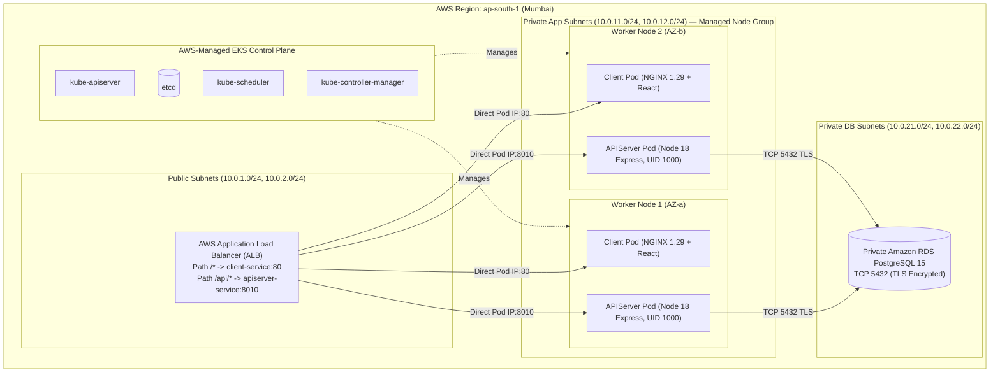
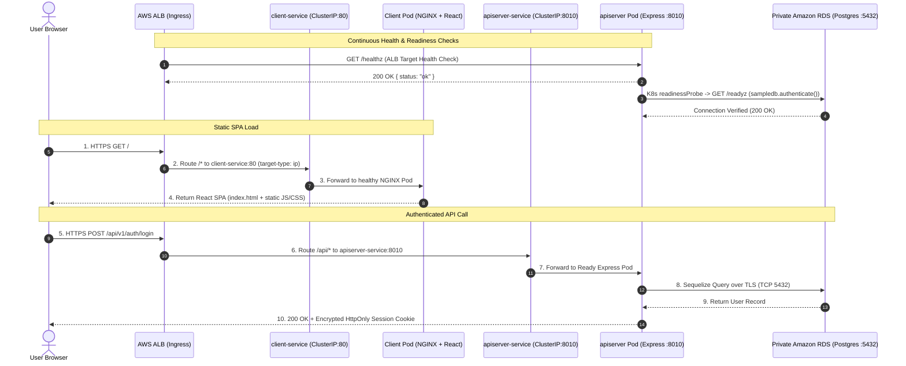

# Kubernetes (Amazon EKS) Architecture & Production Manifest Deep Dive

> **Project:** Node.js Skills Management Platform — DevOps Portfolio Architecture  
> **Scope:** Complete Amazon EKS Architecture, Kustomize Manifest Breakdown, ALB Ingress Routing, External Secrets, Autoscaling (HPA/PDB), and Operations  
> **Namespace:** `node-react-app`  
> **Status:** Production Reference Documentation

---

## 1. Executive Overview: Cloud-Native Orchestration on Amazon EKS

In our target AWS architecture (`ap-south-1` Mumbai), **Amazon EKS** runs our stateless application tiers (**React/NGINX Frontend** and **Node.js/Express Backend API**) across private application subnets, while stateful relational data resides in **Private Amazon RDS for PostgreSQL 15**.

### Evolution: Local Docker Compose vs. Production Amazon EKS

| Capability | Local Docker Compose (`docker-compose.yaml`) | Production Amazon EKS (`k8s/` + `infra/`) |
| :--- | :--- | :--- |
| **Traffic Entrypoint** | NGINX container on host port `:80` reverse-proxying `/api/` | Single internet-facing **AWS ALB** managed by **AWS Load Balancer Controller Ingress** (`target-type: ip`) |
| **Service Exposure** | Host port bindings (`80:80`, `8010:8010`, `5432:5432`) | Private **`ClusterIP` Services** (`client-service:80`, `apiserver-service:8010`) — no direct public node exposure |
| **Self-Healing** | Container `restart: unless-stopped` | Distinct **Startup, Liveness (`/healthz`), and Readiness (`/readyz`) Probes** with automatic Pod replacement |
| **Autoscaling & HA** | Manual container scaling | **HorizontalPodAutoscaler (`hpa.yaml`)** + **PodDisruptionBudget (`pdb.yaml`)** across Availability Zones |
| **Secrets Management** | Local `.config.env` file (gitignored & dockerignored) | **AWS Secrets Manager** synced via **External Secrets Operator (`external-secret.yaml`)** + **IRSA (`serviceaccount.yaml`)** |
| **Database Tier** | Local `postgres:15-alpine` container + `dbdata` volume | **Private Amazon RDS for PostgreSQL 15** over TLS (`DB_SSL=true`) on TCP `5432` |

---

## 2. Amazon EKS Cluster & VPC Topology



---

## 3. Complete `k8s/` Manifest Inventory & Kustomize Overlays

```text
k8s/
 ├── namespace.yaml                ──► 1. Isolated Namespace (node-react-app)
 ├── serviceaccount.yaml           ──► 2. Workload Identity ServiceAccount (IRSA)
 ├── rbac.yaml                     ──► 3. Namespace-Scoped Least-Privilege Role & RoleBinding
 ├── configmap.yaml                ──► 4. Non-Sensitive Config (PORT=8010, DB_HOST, DB_SSL, etc.)
 ├── secret.yaml                   ──► 5. Local K8s Secret Template (Aligned with DB_USER, DB_PASS, JWT_*, SESSION_*)
 ├── external-secret.yaml          ──► 6. AWS Secrets Manager -> K8s Secret Sync (External Secrets Operator)
 ├── apidep.yaml                   ──► 7. Backend Deployment (UID 1000, Probes, Resources, RollingUpdate)
 ├── apisrc.yaml                   ──► 8. Backend Internal Service (ClusterIP :8010)
 ├── clientdep.yaml                ──► 9. Frontend Deployment (NGINX 1.29, /nginx-health Probes, Resources)
 ├── clientsrc.yaml                ──► 10. Frontend Internal Service (ClusterIP :80)
 ├── ingress.yaml                  ──► 11. AWS ALB Ingress (/api -> apiserver-service, / -> client-service)
 ├── hpa.yaml                      ──► 12. HorizontalPodAutoscalers (apiserver 2-6 Pods, client 2-4 Pods)
 ├── pdb.yaml                      ──► 13. PodDisruptionBudgets (minAvailable: 1)
 ├── kustomization.yaml            ──► 14. Base Kustomize Assembly
 ├── dbpvc.yaml / dbdep.yaml / dbsrc.yaml ──► (Optional Local Kind/Minikube In-Cluster Postgres Reference)
 └── overlays/
      ├── lab/kustomization.yaml        ──► Low-cost AWS EKS Lab Overlay (1 replica, Lab RDS endpoint, DB_SSL=true)
      └── production/kustomization.yaml ──► Multi-AZ Production Overlay (3 API replicas, ExternalSecret, Prod RDS)
```

---

## 4. End-to-End Request & Probe Flow Sequence Diagram



---

## 5. Essential Kubernetes Operational & Troubleshooting Commands

```powershell
# 1. Render and validate Kustomize overlays locally before applying to a cluster
kubectl kustomize k8s
kubectl kustomize k8s/overlays/lab
kubectl kustomize k8s/overlays/production

# 2. Deploy the lab overlay to Amazon EKS
kubectl apply -k k8s/overlays/lab

# 3. Inspect rollout status, Pods, Services, EndpointSlices, Ingress, HPA, and PDB
kubectl rollout status deployment/apiserver -n node-react-app
kubectl get deploy,po,svc,endpointslices,ingress,hpa,pdb -n node-react-app -o wide

# 4. Roll back immediately if a bad release fails readiness probes
kubectl rollout undo deployment/apiserver -n node-react-app
```
