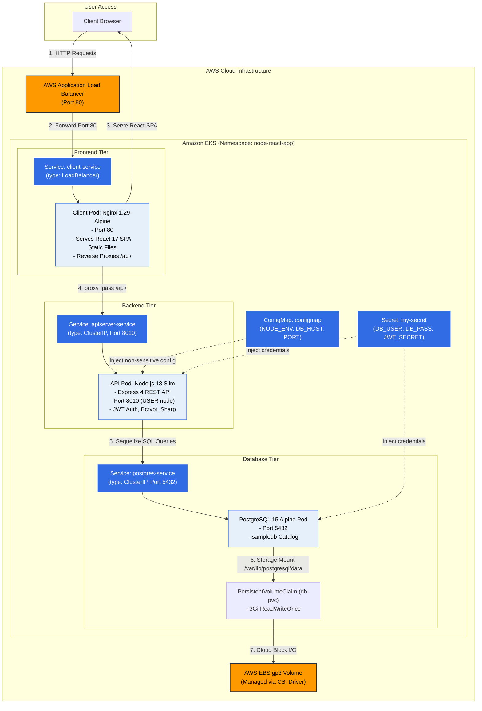

# FullStack DevOps Pipeline — Skills Management Platform

[](.github/workflows/main.yaml)
[](apiserver/Dockerfile)
[](k8s/)
[](sonar-project.properties)
[](.github/workflows/main.yaml)

A production-grade, 3-tier **Skills Management & Professional Portfolio Web Application** automated with an enterprise DevOps lifecycle: **Docker multi-stage containerization**, **Kubernetes (AWS EKS) orchestration**, **GitHub Actions CI/CD automation**, **Jest test coverage gates (50%+)**, and **SonarQube code quality analysis**.

---

## 🏛 System Architecture Blueprint



---

## 🛠 Technology Stack

### Application Services
* **Frontend:** React 17, Ant Design, React Router 6, Axios.
* **Backend:** Node.js 18, Express 4, Sequelize ORM, JWT authentication, Bcrypt password hashing, Sharp image processing.
* **Database:** PostgreSQL 15 (Alpine Linux).

### DevOps & Infrastructure
* **Containerization:** Docker Multi-Stage builds (`node:18-bullseye-slim` $\to$ `nginx:1.29-alpine`), Docker Compose with healthchecks.
* **Orchestration:** Kubernetes (EKS), 10 YAML manifests (Deployments, Services, ConfigMaps, Secrets, PVCs).
* **CI/CD Automation:** GitHub Actions (matrix parallel testing, SonarQube quality analysis, Trivy vulnerability scans).
* **Testing:** Jest 29 + Supertest (62 total unit & integration tests) enforcing a 50% coverage threshold.
* **Security & Quality:** Non-root containers (`USER node`), SonarQube LTS static analysis, Aqua Security Trivy.

---

## 📂 Repository File Tree

```
FullStack-DevOps-Pipeline/
├── apiserver/                       # Express REST API Server
│   ├── __tests__/                   # Unit & Integration tests (43 tests)
│   ├── controllers/                 # Route handlers (auth, skills, users)
│   ├── middleware/                  # Auth verification, error handling, file uploads
│   ├── models/                      # Sequelize ORM models
│   ├── Dockerfile                   # node:18-slim, npm ci layer caching, USER node
│   └── jest.config.js               # Jest coverage threshold configuration (50% min)
│
├── client/                          # React Frontend SPA
│   ├── src/__tests__/               # Component unit tests (19 tests)
│   ├── Dockerfile                   # Multi-stage: Node builder -> Nginx runtime (~23MB)
│   └── nginx.conf                   # Reverse proxy configuration (try_files + proxy_pass)
│
├── k8s/                             # Kubernetes Production Manifests (10 YAMLs)
│   ├── namespace.yaml               # node-react-app isolated namespace
│   ├── configmap.yaml               # Non-sensitive configuration parameters
│   ├── secret.yaml                  # Base64-encoded DB creds & JWT secrets
│   ├── dbpvc.yaml                   # 3Gi PersistentVolumeClaim for PostgreSQL
│   ├── dbdep.yaml / dbsrc.yaml      # PostgreSQL Deployment & ClusterIP Service
│   ├── apidep.yaml / apisrc.yaml    # Express API Deployment & ClusterIP Service
│   └── clientdep.yaml / clientsrc.yaml # React Client Deployment & LoadBalancer Service
│
├── docker-compose.yaml              # Local multi-container development with healthchecks
├── sonar-project.properties         # SonarQube code quality analysis configuration
├── ARCHITECTURE.md                  # Comprehensive Architecture Decision Records (ADR)
└── interview-notes/                 # Complete 1–4 Year DevOps Interview Preparation Kit
```

---

## 🚀 Quick Start Guide

### 1. Local Development with Docker Compose

```bash
# 1. Clone the repository
git clone https://github.com/sahil9079/node-react-postgres.git
cd node-react-postgres

# 2. Setup environment variables
cp apiserver/example.env apiserver/.config.env

# 3. Launch the full 3-tier stack
docker-compose up -d

# 4. Access the application:
# Frontend UI:  http://localhost:80
# Backend API:  http://localhost:8010/api/v1
```

---

### 2. Running Automated Tests & Coverage

```bash
# Run API Server tests (43 unit & integration tests)
cd apiserver
npm install
npm test -- --coverage

# Run React Client tests (19 component tests)
cd ../client
npm install
npm test -- --coverage
```

---

### 3. Deploying to Kubernetes (Amazon EKS)

```bash
# 1. Create the dedicated namespace
kubectl apply -f k8s/namespace.yaml

# 2. Deploy all configuration and workload manifests
kubectl apply -f k8s/ -n node-react-app

# 3. Verify deployment health
kubectl get pods -n node-react-app -o wide
kubectl get svc client-service -n node-react-app
```

---

## 📚 DevOps Technical Interview Preparation Kit

The repository includes a comprehensive, project-grounded interview preparation suite inside [`interview-notes/`](file:///d:/javascript_project/node-react-postgres/interview-notes/):

* **[01-level-1-fundamentals/](interview-notes/01-level-1-fundamentals/)** — 1-Year Associate DevOps (Linux, Git, Dockerfiles, K8s manifests).
* **[02-level-2-intermediate/](interview-notes/02-level-2-intermediate/)** — 2-Year Mid-Level DevOps ("Why & How" decisions, Request flow, Terraform remote state).
* **[03-level-3-production-incidents/](interview-notes/03-level-3-production-incidents/)** — 3–3.5-Year Senior Operations (HTTP 500/502 triage, CrashLoopBackOff, Memory leaks, Emergency rollbacks, 5-Whys RCA).
* **[04-level-4-system-design-and-architecture/](interview-notes/04-level-4-system-design-and-architecture/)** — 4-Year Platform Architect (Scaling to 1M users, S3+CloudFront, Multi-AZ RDS, Karpenter autoscaling, SRE SLOs).
* **[05-project-deep-dive/](interview-notes/05-project-deep-dive/)** — Project defense, 60-second elevator pitch, and real troubleshooting stories.
* **[README.md](interview-notes/README.md)** — Master roadmap and revision index.
