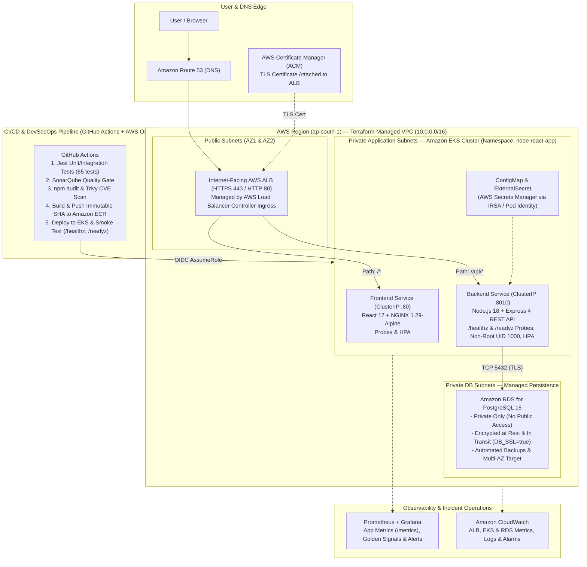

# Node.js Skills Management Platform — Production DevOps Portfolio Architecture

[](.github/workflows/main.yaml)
[](apiserver/Dockerfile)
[](k8s/)
[](./DEVOPS_IMPLEMENTATION_GUIDE.md)
[](sonar-project.properties)
[](.github/workflows/main.yaml)

A production-style, 3-tier **Skills Management Platform** (**React 17 + Node.js/Express 4 + PostgreSQL 15**) engineered for real-world **DevOps & Cloud Infrastructure** workflows across **Docker**, **Docker Compose**, **NGINX**, **Prometheus & Grafana**, **Terraform**, **AWS (`ap-south-1` Mumbai)**, **Amazon ECR**, **Amazon EKS**, **Private Amazon RDS**, **AWS Load Balancer Controller (ALB Ingress)**, **GitHub Actions (OIDC)**, **SonarQube**, **Trivy**, and **Amazon CloudWatch**.

---

## 📘 Essential DevOps Engineering Manuals (Start Here!)

0. 👉 **[HOW_TO_READ_AND_MASTER_THIS_PROJECT.md](./HOW_TO_READ_AND_MASTER_THIS_PROJECT.md)** — **Fresher-to-Senior DevOps Reading Order & Self-Implementation Guide**: Exact 12-step file reading order, ports/env map, complete code explanations, and 6 hands-on break-and-fix drills you can run yourself.
1. 👉 **[DEVOPS_IMPLEMENTATION_GUIDE.md](./DEVOPS_IMPLEMENTATION_GUIDE.md)** — **Complete Step-by-Step Hinglish Implementation Manual (Phases 0 to 15)**, including the **48-Term Official DevOps Dictionary**, exact commands, architecture decisions, 9 production incident runbooks, and interview Q&A.
2. 👉 **[AWS_COST_OPTIMIZATION_AND_CLEANUP.md](./AWS_COST_OPTIMIZATION_AND_CLEANUP.md)** — **FinOps Cost Control, Workload Pause & Dependency-Ordered Teardown Guide** covering Operation A (Local stop without data loss), Operation B (Temporary AWS pause), and Operation C (Safe teardown + 11 post-destroy AWS CLI checks).
3. 👉 **[docs/adr/ADR-001-architecture-and-devops-evolution.md](./docs/adr/ADR-001-architecture-and-devops-evolution.md)** — **Architecture Decision Record** explaining Private RDS vs. in-cluster DB, Single ALB Ingress vs. Service LoadBalancer, and `/healthz` vs. `/readyz`.


---

## 🏛 Target Production Architecture Blueprint (`ap-south-1` Mumbai)



---

## ✅ Project Implementation Checklist (Phases 0–15)

| Phase | Stage Description | Status | Notes / Verification Evidence |
| :--- | :--- | :--- | :--- |
| **Phase 0** | Repository Audit, Git Hygiene (`.gitignore`/`.dockerignore`) & ADR-001 | **Tested** | Fixed `.config.env` Docker build leak; verified CLI tools & baseline tests |
| **Phase 1** | App Verification, Env Standardization (`PORT=8010`, `DB_SSL`) & `/healthz` + `/readyz` | **Tested** | `53/53` API tests (8 suites, >50% global coverage) & `19/19` Client tests (9 suites) passing |
| **Phase 2** | Multi-Stage Dockerfiles, Non-Root Execution (`USER node`) & Image Security | **Implemented** | `apiserver/Dockerfile` (2-stage, `--omit=dev`, non-root) & `client/Dockerfile` (`/nginx-health`) updated |
| **Phase 3** | Docker Compose, PostgreSQL Persistence & NGINX Reverse Proxy | **Tested** | Fixed NGINX `/api/` trailing-slash bug; segmented 3 networks; `docker compose config` verified |
| **Phase 4** | Prometheus Metrics (`/metrics`), Grafana Dashboards & Alert Rules | **Tested** | Zero-dependency `/metrics` endpoint tested in Jest; `deploy/prometheus/` & `deploy/grafana/` created |
| **Phase 5** | Terraform Fundamentals, Modules, S3 Remote State & Native Locking | **Tested** | `infra/bootstrap` & `infra/envs/lab` formatted (`terraform fmt -check`) with S3 `use_lockfile = true` |
| **Phase 6** | AWS VPC, Public/Private/DB Subnets, NAT, Security Groups, IAM & ECR | **Implemented** | `infra/modules/{network,ecr,iam}` created for `ap-south-1` with least-privilege SG chain |
| **Phase 7** | Amazon EKS Cluster, Managed Nodes, Deployments, Probes, HPA & PDB | **Tested** | `infra/modules/eks` + `k8s/` + `k8s/overlays/{lab,production}` validated via `kubectl kustomize` |
| **Phase 8** | Private Amazon RDS PostgreSQL, Secrets Manager, TLS & Backups | **Implemented** | `infra/modules/rds` + `k8s/external-secret.yaml` + `DB_SSL=true` TLS support implemented |
| **Phase 9** | AWS Load Balancer Controller, Ingress, ALB & Path-Based Routing | **Tested** | `k8s/ingress.yaml` + `ClusterIP` Services (`clientsrc.yaml`, `apisrc.yaml`) validated via Kustomize |
| **Phase 10** | GitHub Actions CI/CD, AWS OIDC, Immutable Tags, Rollout & Rollback | **Implemented** | `.github/workflows/main.yaml` & `.github/workflows/deploy-lab.yml` configured with OIDC |
| **Phase 11** | DevSecOps Gates (SonarQube, Trivy, Secret Scanning & RBAC) | **Implemented** | Fixed `vulnerability-type: 'os,library'`; added `k8s/serviceaccount.yaml` & `k8s/rbac.yaml` |
| **Phase 12** | CloudWatch, Prometheus, Grafana & 9 Production Incident Playbooks | **Implemented** | All 9 runbooks documented in [DEVOPS_IMPLEMENTATION_GUIDE.md](./DEVOPS_IMPLEMENTATION_GUIDE.md) |
| **Phase 13** | Reliability Drills, Rolling Updates, Rollback, `k6` Load Tests & RTO/RPO | **Implemented** | `scripts/smoke-test.sh` + `apiserver/k6-tests/` + HPA/PDB/rollout drills documented |
| **Phase 14** | Sprint Workflow, PR Reviews, Workplace Communication & Interview Kit | **Implemented** | Complete Hinglish dictionary (48 terms) & interview defense in guide |
| **Phase 15** | AWS Cost Optimisation, Workload Pause & Dependency-Ordered Teardown | **Implemented** | Documented in [AWS_COST_OPTIMIZATION_AND_CLEANUP.md](./AWS_COST_OPTIMIZATION_AND_CLEANUP.md) + `scripts/post-destroy-check.sh` |

---

## 🚀 Quick Start & Local Verification Commands

### 1. Run Automated Unit & Integration Tests (Phase 0 & Phase 1)

```powershell
# 1. Run Backend API Tests (53 unit & integration tests including /healthz, /readyz & /metrics)
cd apiserver
npm test -- --coverage

# 2. Run Frontend React Tests (19 component & utility tests)
cd ../client
npm test -- --watchAll=false
```

### 2. Run the Full 3-Tier Stack Locally with Docker Compose

```powershell
# 1. Create your local environment file (ignored by Git and Docker build context)
Copy-Item apiserver/example.env apiserver/.config.env

# 2. Start PostgreSQL, Express API (port 8010), and React/NGINX (port 80)
docker compose up --build -d

# 3. Verify Liveness and Readiness Probes
curl.exe -i http://localhost:8010/healthz
curl.exe -i http://localhost:8010/readyz

# 4. Stop local containers WITHOUT deleting PostgreSQL volume data (See Operation A)
docker compose stop
```

---

## 📚 Audit Reports & Beginner-to-3+ Years Interview Preparation Program

### Repository Audit & Verification Reports (`docs/`)
* **[docs/REPOSITORY_INVENTORY.md](./docs/REPOSITORY_INVENTORY.md)** — Complete repository directory tree, file inventory, toolchain versions & dependency catalog.
* **[docs/COMPLETE_REPOSITORY_REVIEW.md](./docs/COMPLETE_REPOSITORY_REVIEW.md)** — Exhaustive file-by-file and cross-file audit (`F-01` to `F-10`) with severity ratings.
* **[docs/BASELINE_VALIDATION.md](./docs/BASELINE_VALIDATION.md)** — Executed baseline test & validation outputs (`53/53` API tests, `19/19` Client tests, Compose, Kustomize, Terraform).
* **[docs/CODE_REVIEW_REPORT.md](./docs/CODE_REVIEW_REPORT.md)** — Controlled fix report, line-by-line explanations, and residual architectural risks.
* **[docs/AWS_COST_OPTIMIZATION_AND_CLEANUP.md](./docs/AWS_COST_OPTIMIZATION_AND_CLEANUP.md)** — AWS FinOps, idle cost analysis, temporary pause & dependency-ordered teardown runbook.

### 16-Module Structured Learning & 60-Scenario Interview Curriculum (`docs/devops-interview-preparation/`)
1. **[00-LEARNING-ROADMAP.md](./docs/devops-interview-preparation/00-LEARNING-ROADMAP.md)** — 4-Level progression (Fresher $\to$ Junior $\to$ Intermediate $\to$ ~3+ Years).
2. **[01-LINUX-AND-NETWORKING.md](./docs/devops-interview-preparation/01-LINUX-AND-NETWORKING.md)** — Processes (`PID 1`, `SIGTERM`), permissions (`UID 1000`), DNS & NGINX reverse proxy.
3. **[02-GIT-AND-GITHUB.md](./docs/devops-interview-preparation/02-GIT-AND-GITHUB.md)** — `.gitignore`/`.dockerignore` hygiene, PR gates, and secret remediation.
4. **[03-DOCKER-AND-COMPOSE.md](./docs/devops-interview-preparation/03-DOCKER-AND-COMPOSE.md)** — Multi-stage builds, layer caching, 3-tier bridge networks, and `stop` vs `down -v`.
5. **[04-CI-CD-AND-GITHUB-ACTIONS.md](./docs/devops-interview-preparation/04-CI-CD-AND-GITHUB-ACTIONS.md)** — CI matrix, coverage artifacts, AWS OIDC `AssumeRoleWithWebIdentity` & rollout undo.
6. **[05-AWS-AND-CLOUD-INFRASTRUCTURE.md](./docs/devops-interview-preparation/05-AWS-AND-CLOUD-INFRASTRUCTURE.md)** — `ap-south-1` 3-tier VPC, NAT trade-offs, SG chaining, ECR & Private RDS.
7. **[06-TERRAFORM-AND-IAC.md](./docs/devops-interview-preparation/06-TERRAFORM-AND-IAC.md)** — S3 bootstrap, native state locking (`use_lockfile = true`), modules & drift detection.
8. **[07-KUBERNETES-AND-EKS.md](./docs/devops-interview-preparation/07-KUBERNETES-AND-EKS.md)** — Deployments, `ClusterIP` Services, ALB Ingress, `/healthz` vs `/readyz`, HPA, PDB & Kustomize.
9. **[08-DEVSECOPS-AND-SECURITY.md](./docs/devops-interview-preparation/08-DEVSECOPS-AND-SECURITY.md)** — SonarQube SAST, `npm audit` SCA, Trivy filesystem/image scans, IRSA & RBAC.
10. **[09-MONITORING-AND-OBSERVABILITY.md](./docs/devops-interview-preparation/09-MONITORING-AND-OBSERVABILITY.md)** — Four Golden Signals, `/metrics` cardinality normalization, PromQL, Grafana & SLIs/SLOs.
11. **[10-PRODUCTION-TROUBLESHOOTING.md](./docs/devops-interview-preparation/10-PRODUCTION-TROUBLESHOOTING.md)** — Structured runbooks for `502`/`503`, `CrashLoopBackOff`, `OOMKilled`, and DB pool exhaustion.
12. **[11-REAL-WORLD-SCENARIO-QUESTIONS.md](./docs/devops-interview-preparation/11-REAL-WORLD-SCENARIO-QUESTIONS.md)** — **60 Scenario-Based Questions** (15 per level × 4 levels) with separated hints and solutions.
13. **[12-ADVANCED-3-YEARS-EXPERIENCE.md](./docs/devops-interview-preparation/12-ADVANCED-3-YEARS-EXPERIENCE.md)** — Architectural trade-offs, DB connection pool math, and zero-downtime migrations.
14. **[13-DEVOPS-TERMINOLOGY-AND-COMMUNICATION.md](./docs/devops-interview-preparation/13-DEVOPS-TERMINOLOGY-AND-COMMUNICATION.md)** — Official glossary + cross-team communication templates.
15. **[14-MOCK-INTERVIEW-AND-SCORECARD.md](./docs/devops-interview-preparation/14-MOCK-INTERVIEW-AND-SCORECARD.md)** — Interactive 1-question-at-a-time mock interview mode & scorecard.
16. **[15-AWS-COST-OPTIMIZATION-AND-CLEANUP.md](./docs/devops-interview-preparation/15-AWS-COST-OPTIMIZATION-AND-CLEANUP.md)** — FinOps interview synthesis & teardown defense.

### Additional Study Archives in Repository
* **[DEVOPS_IMPLEMENTATION_GUIDE.md](./DEVOPS_IMPLEMENTATION_GUIDE.md)** & **[AWS_COST_OPTIMIZATION_AND_CLEANUP.md](./AWS_COST_OPTIMIZATION_AND_CLEANUP.md)**
* **[interview-notes/](./interview-notes/README.md)** & **[DevOps-Interview-Preparation/](./DevOps-Interview-Preparation/README.md)**

