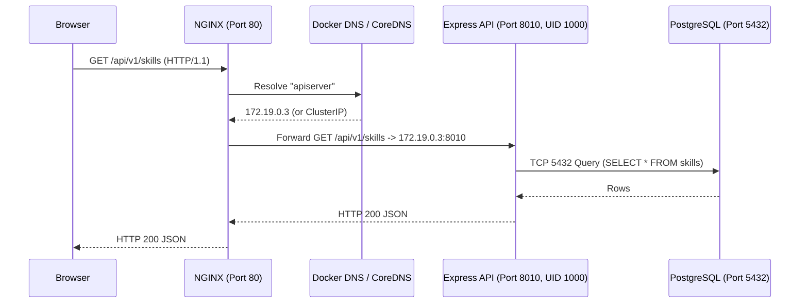

# 01 — Linux & Networking for DevOps (`01-LINUX-AND-NETWORKING.md`)

---

## 1. Simple Hinglish Explanation & Official English Terminology

Jab aapki Node.js API (`apiserver`) ya NGINX (`client`) container ya EC2 node ke andar run hoti hai, toh woh **Linux Kernel** ke upar ek **Process** hoti hai jo ek **TCP Socket (`IP:Port`)** par listen karti hai.
- **Process & PID 1**: Container ke andar jo main command (`CMD ["node", "index.js"]`) chalta hai, uska Process ID `PID 1` hota hai. Jab Kubernetes Pod ko band karta hai, woh `PID 1` ko **`SIGTERM`** signal bhejta hai ([apiserver/index.js](file:///d:/javascript_project/node-react-postgres/apiserver/index.js#L38)).
- **File Permissions & Non-Root UID (`1000`)**: [apiserver/Dockerfile](file:///d:/javascript_project/node-react-postgres/apiserver/Dockerfile#L25) mein hum `chown -R node:node /app/images` aur `USER node` (`UID 1000`) use karte hain taaki agar container compromise ho jaye, toh attacker ko root (`UID 0`) access na mile.
- **DNS Resolution & Reverse Proxy**: Jab browser `http://localhost/api/v1/skills` call karta hai, NGINX (`Port 80`) `proxy_pass http://apiserver:8010;` use karke internal DNS (`127.0.0.11` in Docker Compose or CoreDNS in Kubernetes) se `apiserver` ka IP nikalta hai aur TCP port `8010` par packet forward karta hai.

---

## 2. Why It Is Used in Real Organizations

90% production outages ("502 Bad Gateway", "Connection Refused", "Permission Denied writing to `/app/images`", "Host not found in upstream") Linux permissions, process signals, ya DNS/TCP networking issues hote hain.



---

## 3. Practical Commands, Config & Verification

```bash
# 1. Check non-root user and UID inside the running apiserver container
docker compose exec apiserver id
# Expected output: uid=1000(node) gid=1000(node) groups=1000(node)

# 2. Check directory ownership for profile image uploads (/app/images)
docker compose exec apiserver ls -ld /app/images
# Expected output: drwxr-xr-x 1 node node 4096 ... /app/images

# 3. Verify DNS resolution and TCP connectivity from NGINX container to API container
docker compose exec client wget -qO- http://apiserver:8010/healthz
# Expected output: {"status":"ok","service":"apiserver","uptime":...}
```

---

## 4. Common Mistakes, Security & Hands-On Lab

- **Mistake 1**: Container ke andar `USER node` set kar dena par `/app/images` folder ka owner `root:root` chhod dena $\to$ jab user profile photo upload karega (`userController.js`), `sharp` **`EACCES: permission denied`** throw karega.
- **Mistake 2**: Express server ko `127.0.0.1` (loopback) par bind kar dena instead of `0.0.0.0` $\to$ container ke andar `curl localhost:8010` chalega par NGINX container se `Connection refused` aayega.
- **Hands-On Lab**: Run `docker compose up -d`, then run `docker compose exec apiserver ps aux` and verify `node index.js` runs under `node` user and handles `docker compose stop apiserver` with `👋 SIGTERM RECEIVED. Shutting down gracefully`.

---

## 5. Interview & Scenario Questions (With Honest Answer & Follow-Ups)

- **Q1 (Beginner)**: *What is the difference between HTTP `502 Bad Gateway`, `503 Service Unavailable`, and `504 Gateway Timeout` on NGINX or AWS ALB?*
  - **Honest Answer**: "`502 Bad Gateway` means NGINX or the ALB tried to connect to the upstream `apiserver:8010` socket, but got a TCP `RST` (Connection Refused) or invalid response because the Node process crashed. `503 Service Unavailable` means no healthy backend targets are registered in the target group (for example, `/readyz` returned 503 because PostgreSQL is unreachable). `504 Gateway Timeout` means `apiserver` accepted the TCP connection but took longer than the proxy timeout to respond (for example, due to a slow database query)."
  - **Interviewer Follow-Up**: *How would you check inside a minimal Alpine container whether port 8010 is listening if `netstat` and `curl` are not installed?*
  - **Answer**: "In our `node:18-alpine` image, we can check `/proc/net/tcp` or run a one-line Node.js probe: `node -e \"require('http').get('http://127.0.0.1:8010/healthz', r => console.log(r.statusCode))\"`, which is the exact technique we use in our `apiserver/Dockerfile` `HEALTHCHECK`."
