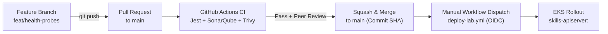

# 02 — Git, GitHub & Enterprise Release Workflow (`02-GIT-AND-GITHUB.md`)

---

## 1. Simple Hinglish Explanation & Official English Terminology

Real organization mein koi bhi DevOps engineer ya developer seedha `main` branch par code push nahi karta.
- **Repository Hygiene (`.gitignore` & `.dockerignore`)**: `.gitignore` Git history mein secrets (`.config.env`, `*.tfvars`), state files (`*.tfstate`), aur `node_modules/` jane se rokta hai. `.dockerignore` Docker daemon ko build context bhejte waqt `.config.env` aur `.git` folder image layer mein copy (`COPY . .`) hone se rokta hai.
- **Branch Protection & Pull Request (PR) Quality Gates**: Developer feature/fix branch (`fix/nginx-upstream-dns`) banata hai, PR raise karta hai, aur GitHub Actions ([.github/workflows/main.yaml](file:///d:/javascript_project/node-react-postgres/.github/workflows/main.yaml)) automatically Jest tests, SonarQube, aur Trivy scan run karta hai.
- **Immutable Release Traceability**: Har merge commit ka Git SHA (`${{ github.sha }}`) hi Docker image ka tag banta hai ([.github/workflows/deploy-lab.yml](file:///d:/javascript_project/node-react-postgres/.github/workflows/deploy-lab.yml#L50)), jisse production mein chal rahe Pod se exact Git commit 5 second mein trace ho jata hai.

---

## 2. Enterprise Git & PR Workflow Diagram



---

## 3. Practical Commands, Config & Verification

```bash
# 1. Verify that sensitive files are ignored by Git
git check-ignore -v apiserver/.config.env infra/envs/lab/terraform.tfstate
# Expected output:
# .gitignore:28:*.env   apiserver/.config.env
# .gitignore:45:*.tfstate       infra/envs/lab/terraform.tfstate

# 2. Create a clean feature branch, inspect diff before staging, and commit with Conventional Commits
git checkout -b fix/k8s-service-dns
git status --short
git diff k8s/apisrc.yaml
git add k8s/apisrc.yaml
git commit -m "fix(k8s): add apiserver service alias for nginx upstream dns"
```

---

## 4. Common Mistakes, Security & Hands-On Lab

- **Mistake 1**: `.gitignore` mein `.config.env` dalna par `apiserver/.dockerignore` mein bhool jana $\to$ local machine par `docker build` karte waqt `.config.env` image ke andar bake ho jata hai aur ECR/DockerHub par push ho jata hai! (Humne Phase 0 mein `apiserver/.dockerignore` mein `.config.env` add karke is leak ko band kiya).
- **Mistake 2**: Agar koi secret galti se Git commit mein chala gaya, toh sirf agle commit mein `git rm` karne se woh Git history (`git log -p`) se nahi hat-ta. Us secret ko **immediately rotate/revoke** karna padta hai.
- **Hands-On Lab**: Run `git status --ignored` in the repository root to inspect all untracked/ignored files and verify `.config.env` is listed under `Ignored files`.

---

## 5. Interview & Scenario Questions

- **Q1 (Intermediate)**: *A developer accidentally committed an AWS secret or `.config.env` to a feature branch and pushed it. Even after deleting the file in a new commit, Trivy/GitLeaks still flags the repository. Why, and what is your exact remediation step-by-step?*
  - **Honest Answer**: "Deleting a file in a subsequent commit only removes it from the `HEAD` tree, not from previous Git commit objects in `.git/objects`. First, I treat the credential as compromised and **immediately rotate/revoke** the secret in AWS IAM or Secrets Manager. Second, I remove the file from Git history using `git filter-repo` or BFG Repo-Cleaner and force-push the cleaned branch. Finally, I add `.config.env` to `.gitignore` and `.dockerignore` and enable pre-commit / CI secret scanning so it cannot recur."
