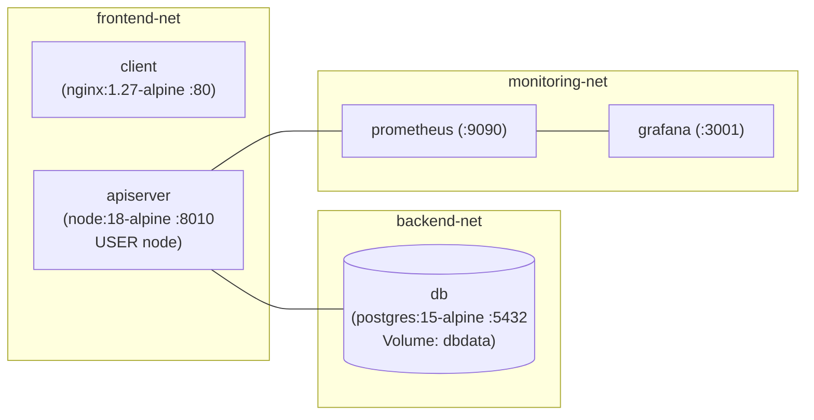

# 03 — Docker & Docker Compose Mastery (`03-DOCKER-AND-COMPOSE.md`)

---

## 1. Simple Hinglish Explanation & Official English Terminology

- **Multi-Stage Build**: [client/Dockerfile](file:///d:/javascript_project/node-react-postgres/client/Dockerfile) mein Stage 1 (`FROM node:18-alpine AS build`) React code compile karke `/app/build` banata hai (jismein 500MB+ `node_modules` lagte hain), aur Stage 2 (`FROM nginx:1.27-alpine`) sirf compiled static files (`/app/build`) ko copy karta hai. Final image ~45MB ki banti hai aur usmein Node.js ya source code nahi rehta.
- **Layer Caching**: `COPY package*.json ./` aur `RUN npm ci --omit=dev` ko `COPY . .` se pehle likha jata hai ([apiserver/Dockerfile](file:///d:/javascript_project/node-react-postgres/apiserver/Dockerfile#L5-L6)) taaki jab sirf `.js` code badle, Docker dependency installation layer ko cache se reuse kare.
- **Network Segmentation in Docker Compose**: [docker-compose.yaml](file:///d:/javascript_project/node-react-postgres/docker-compose.yaml) mein 3 alag networks hain: `frontend-net` (`client` $\leftrightarrow$ `apiserver`), `backend-net` (`apiserver` $\leftrightarrow$ `db`), aur `monitoring-net` (`prometheus`/`grafana` $\leftrightarrow$ `apiserver`). Isse `client` container seedha PostgreSQL (`db`) ko ping bhi nahi kar sakta.

---

## 2. Container Build & Compose Network Architecture



---

## 3. Complete Configuration & Critical Commands

### `docker compose stop` vs `docker compose down` vs `docker compose down -v`
| Command | What It Does | PostgreSQL Data (`dbdata` Volume) Impact |
| :--- | :--- | :--- |
| `docker compose stop` | Sends `SIGTERM` to running containers without removing containers or networks. | **100% Safe** — All users/skills rows remain intact. |
| `docker compose down` | Stops and removes containers and bridge networks, but preserves named volumes. | **100% Safe** — Named volume `dbdata` is preserved on disk. |
| `docker compose down -v` | Stops containers, removes networks, **AND deletes named volumes (`dbdata`, `prometheus_data`, `grafana_data`)**. | **DESTRUCTIVE DATA LOSS** — Wipes the entire PostgreSQL database! Use only when you intentionally want a clean slate. |

```bash
# 1. Validate docker-compose.yaml syntax
docker compose config --quiet

# 2. Build and start the 5-service stack in detached mode
docker compose up --build -d

# 3. Verify container health statuses
docker compose ps
```

---

## 4. Common Mistakes, Security & Hands-On Lab

- **Mistake 1 (`depends_on` without `condition: service_healthy`)**: Simple `depends_on: [db]` sirf container start hone ka wait karta hai, PostgreSQL ke TCP port `5432` par queries accept karne ka nahi. Isliye hum `db` mein `pg_isready -U postgres -d sampledb` healthcheck aur `apiserver` mein `condition: service_healthy` use karte hain ([docker-compose.yaml](file:///d:/javascript_project/node-react-postgres/docker-compose.yaml#L15-L55)).
- **Mistake 2 (Trailing Slash in NGINX `proxy_pass`)**: `location /api/ { proxy_pass http://apiserver:8010/; }` likhne se NGINX `/api/` prefix strip kar deta hai aur `/api/v1/skills` backend par `/v1/skills` bankar jata hai (HTTP 404). Sahi config: `proxy_pass http://apiserver:8010;` ([client/nginx.conf](file:///d:/javascript_project/node-react-postgres/client/nginx.conf#L17)).

---

## 5. Interview & Scenario Questions

- **Q1 (Level 2/3)**: *Why did you use a 2-stage Dockerfile for `apiserver` as well as `client`, and why did you use `npm ci --omit=dev` instead of `npm install`?*
  - **Honest Answer**: "`npm ci` reads `package-lock.json` strictly and fails if `package.json` and the lockfile are out of sync, guaranteeing reproducible builds across developer laptops and CI runners. `--omit=dev` excludes testing libraries like `jest`, `supertest`, and `@babel/*` from the final production image, reducing image size and shrinking the CVE attack surface scanned by Trivy."
