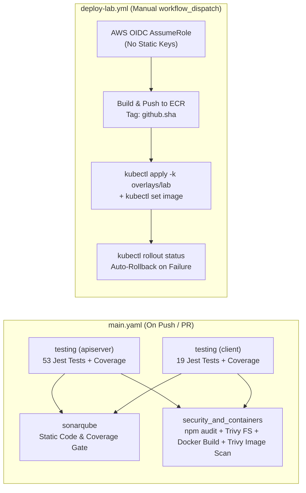

# 04 — CI/CD & GitHub Actions with AWS OIDC (`04-CI-CD-AND-GITHUB-ACTIONS.md`)

---

## 1. Simple Hinglish Explanation & Official English Terminology

Is project mein humne CI aur CD ko 2 separate workflows mein rakha hai:
1. **Continuous Integration ([.github/workflows/main.yaml](file:///d:/javascript_project/node-react-postgres/.github/workflows/main.yaml))**: Har `push` aur `pull_request` par automatically chalta hai. Matrix strategy (`service: [apiserver, client]`) se dono services ke Jest unit/integration tests parallel run hote hain, coverage artifacts (`lcov.info`) SonarQube job ko milte hain, aur `security_and_containers` job `npm audit` + Trivy filesystem/secret scan + multi-stage Docker build + Trivy image scan (`skills-apiserver` aur `skills-client`) execute karta hai.
2. **Continuous Deployment ([.github/workflows/deploy-lab.yml](file:///d:/javascript_project/node-react-postgres/.github/workflows/deploy-lab.yml))**: `workflow_dispatch` (manual approval trigger) par chalta hai taaki bina permission ke AWS par deploy na ho. Yeh **GitHub OIDC (`aws-actions/configure-aws-credentials@v4`)** use karke short-lived STS credentials leta hai, immutable `${{ github.sha }}` tag ke saath ECR par push karta hai, EKS rollout karta hai, aur agar `kubectl rollout status` fail ho jaye toh automatically **`kubectl rollout undo`** chala deta hai.

---

## 2. CI/CD Pipeline Architecture & Job Dependency Graph

---

## 3. Why AWS OIDC Instead of Static `AWS_ACCESS_KEY_ID`?

- **Problem with Static Keys**: Long-lived IAM user keys (`AKIA...`) GitHub Secrets mein save karne par key rotation manual hota hai aur leak hone par permanent breach ho sakta hai.
- **How OIDC Works**: GitHub Actions runner `permissions: id-token: write` ke saath `https://token.actions.githubusercontent.com` se ek signed JWT token generate karta hai. AWS STS Trust Policy ([infra/modules/iam/main.tf](file:///d:/javascript_project/node-react-postgres/infra/modules/iam/main.tf#L27-L35)) verify karti hai ki `sub == "repo:sahil9079/node-react-postgres:ref:refs/heads/main"` hai, aur 1 ghante ka temporary token return karti hai.

---

## 4. Common Mistakes, Troubleshooting & Interview Questions

- **Mistake 1**: `Upload-artifact@v4` aur `Download-artifact@v4` ke directory paths mismatch hona $\to$ SonarQube ko `apiserver/coverage/lcov.info` nahi milta aur coverage 0% dikhti hai (Fixed in `F-02`).
- **Mistake 2**: OIDC error `Not authorized to perform sts:AssumeRoleWithWebIdentity` $\to$ Jab feature branch se deploy karne ki koshish ki jaye jabki IAM trust condition mein `ref:refs/heads/main` locked ho.
- **Interview Question**: *How do you ensure a bad deployment in GitHub Actions does not leave broken Pods in EKS?*
  - **Honest Answer**: "In `deploy-lab.yml`, our Kubernetes Deployments use `maxUnavailable: 0, maxSurge: 1` along with a `/readyz` readiness probe that checks PostgreSQL connectivity. After running `kubectl set image`, the workflow runs `kubectl rollout status --timeout=180s`. If the new Pods fail their readiness probe, old Pods continue serving traffic and the workflow triggers `kubectl rollout undo deployment/apiserver -n node-react-app` automatically."
