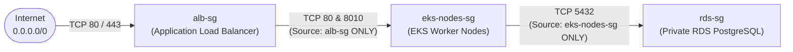

# 05 — AWS & Production Cloud Infrastructure (`05-AWS-AND-CLOUD-INFRASTRUCTURE.md`)

---

## 1. Simple Hinglish Explanation & Official English Terminology

Humara target AWS architecture **`ap-south-1` (Mumbai)** mein **3-Tier Defense-in-Depth VPC (`10.0.0.0/16`)** follow karta hai ([infra/modules/network/main.tf](file:///d:/javascript_project/node-react-postgres/infra/modules/network/main.tf)):
1. **Public Subnets (`10.0.1.0/24`, `10.0.2.0/24`)**: Yahan sirf **AWS Application Load Balancer (ALB)** aur **NAT Gateway** rehte hain. Inka route `0.0.0.0/0` **Internet Gateway (IGW)** par jata hai.
2. **Private App Subnets (`10.0.11.0/24`, `10.0.12.0/24`)**: Yahan **Amazon EKS Managed Node Group** (`client` aur `apiserver` Pods) chalta hai. Internet se koi seedha in nodes ko connect nahi kar sakta; outbound image pull/OS updates ke liye traffic NAT Gateway se bahar jata hai.
3. **Private Isolated DB Subnets (`10.0.21.0/24`, `10.0.22.0/24`)**: Yahan **Private Amazon RDS PostgreSQL 15** (`sampledb`) rehta hai (`publicly_accessible = false`). Is subnet mein IGW ya NAT Gateway ka bhi route nahi hota (100% isolated).

---

## 2. Security Group Chaining (Strict Least-Privilege Network Flow)



- **Why SG Chaining Matters**: `rds-sg` mein hum CIDR (`0.0.0.0/0` ya `10.0.0.0/16`) allow karne ke bajaye **`source_security_group_id = eks-nodes-sg`** allow karte hain ([infra/modules/network/main.tf](file:///d:/javascript_project/node-react-postgres/infra/modules/network/main.tf#L148-L155)). Iska matlab VPC ke andar bhi sirf EKS worker nodes hi port `5432` par बात kar sakte hain.

---

## 3. Practical Verification Commands

```bash
# 1. Pre-flight check of AWS Account ID and Region (ap-south-1)
bash scripts/aws-preflight.sh

# 2. Verify VPC subnets and Kubernetes ALB tags
aws ec2 describe-subnets --region ap-south-1 \
  --filters "Name=tag:Project,Values=skills" \
  --query "Subnets[].[SubnetId,CidrBlock,AvailabilityZone,MapPublicIpOnLaunch]" --output table
```

---

## 4. Common Mistakes & Interview Questions

- **Mistake 1 (Missing Subnet Tags for AWS Load Balancer Controller)**: Agar public subnets par `kubernetes.io/role/elb = 1` aur private subnets par `kubernetes.io/role/internal-elb = 1` tag na ho ([infra/modules/network/main.tf](file:///d:/javascript_project/node-react-postgres/infra/modules/network/main.tf#L55-L78)), toh `k8s/ingress.yaml` apply karne par ALB provision nahi hota aur controller `FailedBuildModel: could not find any suitable subnets` error deta hai.
- **Interview Question**: *Why did you configure 1 NAT Gateway in the `lab` environment (`single_nat_gateway = true`), and how would that change in production?*
  - **Honest Answer**: "A NAT Gateway in `ap-south-1` costs `~\$0.059/hour` (`~\$43/month`) plus per-GB data processing. In our `lab` environment (`infra/envs/lab/main.tf`), setting `single_nat_gateway = true` saves `\$43/month`. However, a single NAT Gateway in `ap-south-1a` is a Single Point of Failure (SPOF)—if `ap-south-1a` has an outage, private nodes in `ap-south-1b` lose outbound internet access. In production, we set `single_nat_gateway = false` to deploy one NAT Gateway per Availability Zone."
