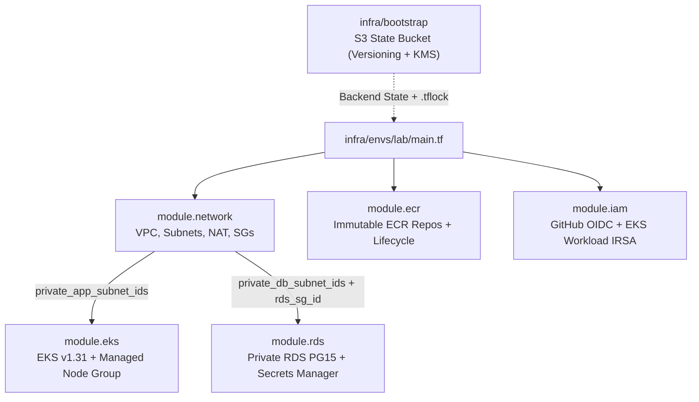

# 06 — Terraform & Infrastructure as Code (`06-TERRAFORM-AND-IAC.md`)

---

## 1. Simple Hinglish Explanation & Official English Terminology

**Infrastructure as Code (IaC)** ka matlab hai AWS console par manual click-ops karne ke bajaye declarative `.tf` files se infrastructure manage karna. Humne `infra/` ko 3 साफ layers mein divide kiya hai:
1. **`infra/bootstrap/main.tf`**: Remote S3 state bucket banata hai jismein Versioning, Server-Side KMS Encryption, aur Public Access Block enabled hain.
2. **`infra/modules/{network,ecr,eks,rds,iam}`**: Reusable building blocks jismein koi hardcoded environment values nahi hain.
3. **`infra/envs/lab/main.tf`**: Root composition jo `ap-south-1` lab ke liye modules ko call karta hai aur **Terraform 1.10+ native S3 state locking (`use_lockfile = true`)** use karta hai (jisse alag DynamoDB lock table ki zaroorat nahi padti).

---

## 2. Terraform Module Dependency Graph



---

## 3. Core Terraform Lifecycle Commands & Verification

```bash
# 1. Format check across all modules
terraform -chdir=infra fmt -check -recursive

# 2. Initialize provider plugins (without connecting to remote S3 backend during local syntax check)
terraform -chdir=infra/envs/lab init -backend=false

# 3. Validate HCL syntax and cross-module variable/output references
terraform -chdir=infra/envs/lab validate

# 4. Generate an execution plan (requires AWS credentials; read-only)
terraform -chdir=infra/envs/lab plan -out=tfplan
```

---

## 4. Common Mistakes, Drift & Interview Questions

- **State File Security**: `terraform.tfstate` mein RDS master password (`var.db_password`) plaintext mein store hota hai, chahe variable `sensitive = true` mark ho! Isliye `.gitignore` mein `*.tfstate*` block hai aur S3 backend par encryption (`encrypt = true`) mandatory hai.
- **Interview Question**: *What happens if two engineers run `terraform apply` at the exact same time, and how did you prevent state corruption in this project?*
  - **Honest Answer**: "Without state locking, concurrent `terraform apply` runs cause race conditions, partial AWS API failures, and a corrupted `terraform.tfstate`. In our `infra/envs/lab/main.tf`, we use Terraform `v1.15`'s native S3 state locking (`use_lockfile = true`), which writes a `.tflock` object to S3 using conditional writes (`If-None-Match`). If a second run starts while a lock exists, Terraform immediately aborts with a state lock error."
