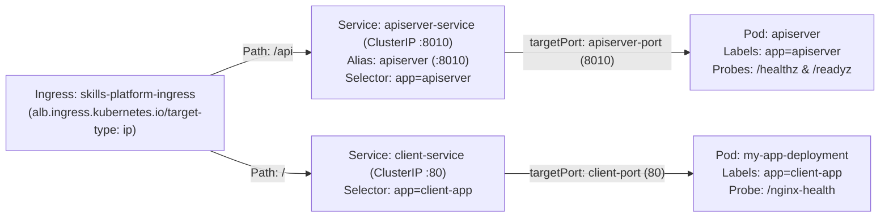

# 07 — Kubernetes & Amazon EKS Deep Dive (`07-KUBERNETES-AND-EKS.md`)

---

## 1. Simple Hinglish Explanation & Official English Terminology

Kubernetes (`k8s/`) mein har manifest ka ek specific operational role hai:
- **Namespace ([k8s/namespace.yaml](file:///d:/javascript_project/node-react-postgres/k8s/namespace.yaml))**: `node-react-app` logical isolation boundary banata hai.
- **ConfigMap & ExternalSecret ([k8s/configmap.yaml](file:///d:/javascript_project/node-react-postgres/k8s/configmap.yaml), [k8s/external-secret.yaml](file:///d:/javascript_project/node-react-postgres/k8s/external-secret.yaml))**: Non-sensitive settings (`PORT=8010`, `DB_SSL`) ConfigMap se aate hain, aur sensitive secrets (`DB_PASS`, `JWT_SESSION_SECRET`) AWS Secrets Manager se sync hokar `my-secret` banate hain.
- **Deployments & Probes ([k8s/apidep.yaml](file:///d:/javascript_project/node-react-postgres/k8s/apidep.yaml), [k8s/clientdep.yaml](file:///d:/javascript_project/node-react-postgres/k8s/clientdep.yaml))**:
  - `startupProbe` (`/healthz`): Container boot hone ke liye 60s (`12 * 5s`) deta hai.
  - `livenessProbe` (`/healthz`): Agar Node.js event loop deadlock ho jaye toh Pod restart karta hai.
  - `readinessProbe` (`/readyz`): Agar PostgreSQL down ho toh Pod ko restart karne ke bajaye Service endpoints se hata deta hai (`503`).
- **Services & Ingress ([k8s/apisrc.yaml](file:///d:/javascript_project/node-react-postgres/k8s/apisrc.yaml), [k8s/clientsrc.yaml](file:///d:/javascript_project/node-react-postgres/k8s/clientsrc.yaml), [k8s/ingress.yaml](file:///d:/javascript_project/node-react-postgres/k8s/ingress.yaml))**: Dono Services `ClusterIP` hain aur ek single **AWS ALB Ingress** (`ingressClassName: alb`, `target-type: ip`) `/api` ko `apiserver-service:8010` par aur `/` ko `client-service:80` par route karta hai.
- **HPA & PDB ([k8s/hpa.yaml](file:///d:/javascript_project/node-react-postgres/k8s/hpa.yaml), [k8s/pdb.yaml](file:///d:/javascript_project/node-react-postgres/k8s/pdb.yaml))**: HPA CPU (`70%`) aur Memory (`80%`) par Pods ko `2` se `6` tak scale karta hai; PDB (`minAvailable: 1`) node drain ke waqt saare Pods ek saath evict hone se rokta hai.

---

## 2. Kubernetes Selector, Label & Port Mapping Diagram



---

## 3. Practical Validation Commands

```bash
# 1. Validate Base (Local K8s with Postgres Pod), Lab Overlay, and Production Overlay
kubectl kustomize k8s
kubectl kustomize k8s/overlays/lab
kubectl kustomize k8s/overlays/production

# 2. Inspect Pod status, events, and logs during troubleshooting
kubectl get deploy,po,svc,ingress,hpa,pdb -n node-react-app
kubectl describe pod -l app=apiserver -n node-react-app
kubectl logs -l app=apiserver -n node-react-app --tail=100
```

---

## 4. Interview Question: Why Separate `/healthz` (Liveness) from `/readyz` (Readiness)?

- **Honest Answer**: "In `apiserver/app.js`, `/healthz` returns `200 OK` immediately without querying PostgreSQL, whereas `/readyz` runs `await sampledb.authenticate()`. If we pointed `livenessProbe` at `/readyz` and Amazon RDS had a 15-second Multi-AZ failover, every `apiserver` Pod would fail liveness and get killed by `kubelet` simultaneously, causing a cascading `CrashLoopBackOff` storm. By using `/readyz` only for `readinessProbe`, Kubernetes simply stops sending user traffic to the Pods while RDS recovers, and automatically resumes traffic as soon as `/readyz` returns `200`."
