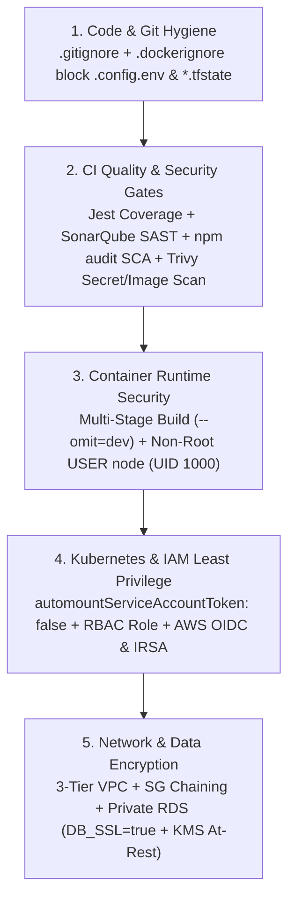

# 08 — DevSecOps & Supply-Chain Security (`08-DEVSECOPS-AND-SECURITY.md`)

---

## 1. Simple Hinglish Explanation & Official English Terminology

**DevSecOps ("Shift-Left Security")** ka matlab hai security checks ko production deploy hone ke baad nahi, balki har Git commit, Docker build, aur Kubernetes manifest level par automate karna:
1. **SAST (Static Application Security Testing)**: SonarQube ([sonar-project.properties](file:///d:/javascript_project/node-react-postgres/sonar-project.properties)) source code mein bugs, code smells, security hotspots, aur test coverage (`>= 50%`) check karta hai.
2. **SCA (Software Composition Analysis)**: `npm audit` `package-lock.json` ke third-party dependencies (`express`, `sequelize`, `jsonwebtoken`) mein known CVEs check karta hai.
3. **Secret & Misconfiguration Scanning**: Trivy (`aquasecurity/trivy-action@0.28.0` with `scanners: "vuln,secret,misconfig"`) repo mein hardcoded AWS keys, private keys, aur Dockerfile/K8s misconfigurations pakadta hai.
4. **Container Image Vulnerability Scanning**: Trivy dono built images (`skills-apiserver:${{ github.sha }}` aur `skills-client:${{ github.sha }}`) ke Alpine OS packages (`apk`) aur Node.js libraries (`os,library`) ko scan karta hai ([.github/workflows/main.yaml](file:///d:/javascript_project/node-react-postgres/.github/workflows/main.yaml#L109-L126)).

---

## 2. Multi-Layer Security Defense-in-Depth Diagram



---

## 3. Practical Commands & Vulnerability Triage

```bash
# 1. Run local dependency vulnerability audit
npm --prefix apiserver audit
npm --prefix client audit

# 2. Verify non-root securityContext in Kubernetes Deployment
kubectl kustomize k8s/overlays/production | Select-String -Context 2,4 "securityContext"
```

### How to Handle False Positives & Residual Risk in Interviews
- **`ignore-unfixed: true` in Trivy**: Agar किसी base Alpine package mein CVE report hua hai jiska upstream maintainer ne abhi patch release nahi kiya hai, toh `ignore-unfixed: true` pipeline ko block hone se bachata hai jabki hum compensating controls (private subnet + non-root container) lagate hain.
- **Dev Dependency vs Production Image Risk**: Agar `client/package.json` ke build toolchain (`react-scripts`) mein koi CVE aata hai, toh multi-stage build ki wajah se woh `nginx:1.27-alpine` production image mein exist hi nahi karta!
