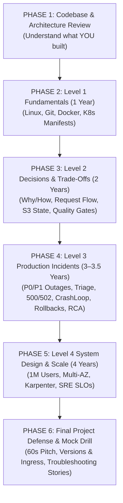

# 🗺️ Master DevOps Interview Revision Roadmap & Study Sequence

> **Target Range:** 1-Year $\to$ 2-Year $\to$ 3.5-Year $\to$ 4-Year Senior DevOps / Platform Engineer  
> **Project Foundation:** 3-Tier Skills Management Platform (React 17 + Express 4 + PostgreSQL 15) with Docker Multi-Stage builds, Kubernetes (EKS), and GitHub Actions CI/CD.

---

## 🧭 Executive Revision Flowchart

---

## 📅 Step-by-Step Study Sequence & Daily Plan

---

### 🔹 PHASE 1: Codebase & Architecture Review (Days 1–2)
> **Goal:** Know every single file in your repository cold so you never hesitate when asked about your code.

1. **Step 1: Read the System Blueprints:**
   * Open and study [`README.md`](../README.md) and [`ARCHITECTURE.md`](../ARCHITECTURE.md).
   * Memorize the visual Mermaid flowcharts: User $\to$ ALB $\to$ Nginx Client $\to$ Express API $\to$ PostgreSQL on EBS.
2. **Step 2: Inspect Your Dockerfiles:**
   * Review [`apiserver/Dockerfile`](../../apiserver/Dockerfile) (focus on `node:18-slim`, `npm ci`, `USER node`).
   * Review [`client/Dockerfile`](../../client/Dockerfile) (focus on multi-stage build: Node builder $\to$ Alpine Nginx runtime).
   * Review [`docker-compose.yaml`](../../docker-compose.yaml) (focus on `pg_isready` healthcheck and `condition: service_healthy`).
3. **Step 3: Inspect Your 10 Kubernetes Manifests:**
   * Browse through [`k8s/`](../../k8s/) in this exact order:
     `namespace.yaml` $\to$ `configmap.yaml` $\to$ `secret.yaml` $\to$ `dbpvc.yaml` $\to$ `dbdep.yaml` $\to$ `dbsrc.yaml` $\to$ `apidep.yaml` $\to$ `apisrc.yaml` $\to$ `clientdep.yaml` $\to$ `clientsrc.yaml`.
4. **Step 4: Inspect CI/CD & Testing:**
   * Review [`.github/workflows/main.yaml`](../../.github/workflows/main.yaml) and [`apiserver/jest.config.js`](../../apiserver/jest.config.js).

---

### 🔹 PHASE 2: Level 1 — Fundamentals & Tool Literacy (Days 3–5)
> **Goal:** Master basic system administration, CLI commands, and fundamental concepts.

* 📖 **Folder to Study:** [`01-level-1-fundamentals/`](01-level-1-fundamentals/)
* **Order of Reading:**
  1. [`01-linux-fundamentals.md`](01-level-1-fundamentals/01-linux-fundamentals.md) — CPU/Memory/Disk inspection (`top`, `free -m`, `df -h`, `kill -15` vs `kill -9`, recovering from 100% disk).
  2. [`02-git-github-fundamentals.md`](01-level-1-fundamentals/02-git-github-fundamentals.md) — Merge vs rebase, resolving merge conflicts, safe reverts (`git revert`).
  3. [`03-docker-containers-fundamentals.md`](01-level-1-fundamentals/03-docker-containers-fundamentals.md) — Container vs VM, line-by-line Dockerfile explanation.
  4. [`04-kubernetes-fundamentals.md`](01-level-1-fundamentals/04-kubernetes-fundamentals.md) — Pod, Service, Deployment, PVC, and essential `kubectl` CLI commands.
  5. [`05-aws-cloud-fundamentals.md`](01-level-1-fundamentals/05-aws-cloud-fundamentals.md) — EC2, VPC, EKS, ALB, EBS, IAM basics, Security Groups vs NACLs.
  6. [`06-cicd-pipeline-fundamentals.md`](01-level-1-fundamentals/06-cicd-pipeline-fundamentals.md) — CI vs CD, GitHub Actions matrix builds, triggers.
  7. [`07-terraform-iac-fundamentals.md`](01-level-1-fundamentals/07-terraform-iac-fundamentals.md) — IaC lifecycle (`init`, `plan`, `apply`, `destroy`), state file.

---

### 🔹 PHASE 3: Level 2 — Intermediate Decisions & "Why/How" (Days 6–8)
> **Goal:** Transition from definitions to explaining **trade-offs and architectural reasoning**.

* 📖 **Folder to Study:** [`02-level-2-intermediate/`](02-level-2-intermediate/)
* **Order of Reading:**
  1. [`01-architecture-decisions-and-tradeoffs.md`](02-level-2-intermediate/01-architecture-decisions-and-tradeoffs.md) — Defending `type: LoadBalancer` vs Ingress, baked vs ConfigMap Nginx config.
  2. [`02-complete-network-and-request-flow.md`](02-level-2-intermediate/02-complete-network-and-request-flow.md) — Packet flow from user browser to PostgreSQL database.
  3. [`03-docker-troubleshooting-and-optimization.md`](02-level-2-intermediate/03-docker-troubleshooting-and-optimization.md) — Cross-platform builds (`arm64` vs `amd64`), non-root UID 1000 permissions.
  4. [`04-kubernetes-networking-and-storage.md`](02-level-2-intermediate/04-kubernetes-networking-and-storage.md) — CoreDNS, Service ports (`port` vs `targetPort` vs `nodePort`), EBS CSI storage.
  5. [`05-terraform-state-locking-and-drift.md`](02-level-2-intermediate/05-terraform-state-locking-and-drift.md) — S3 backend + DynamoDB locking (`LockID`), detecting drift (`-detailed-exitcode`).
  6. [`06-cicd-quality-gates-and-devsecops.md`](02-level-2-intermediate/06-cicd-quality-gates-and-devsecops.md) — Enforcing 50% Jest coverage, SonarQube, Trivy scanning, Git SHA image tags.

---

### 🔹 PHASE 4: Level 3 — Production Incidents & RCA Playbook (Days 9–11)
> **Goal:** Master organizational incident response, live outage triage, emergency rollbacks, and post-mortems.

* 📖 **Folder to Study:** [`03-level-3-production-incidents/`](03-level-3-production-incidents/)
* **Order of Reading:**
  1. [`01-enterprise-p0-p1-incident-management.md`](03-level-3-production-incidents/01-enterprise-p0-p1-incident-management.md) — Incident Commander protocol, war rooms, the rule of *"Mitigate first, investigate second"*.
  2. [`02-http-500-and-backend-crash-triage.md`](03-level-3-production-incidents/02-http-500-and-backend-crash-triage.md) — Unhandled exceptions, Sequelize database drops.
  3. [`03-http-502-bad-gateway-and-nginx-triage.md`](03-level-3-production-incidents/03-http-502-bad-gateway-and-nginx-triage.md) — Nginx upstream connection refused, service selector label mismatches.
  4. [`04-crashloopbackoff-and-oomkilled-triage.md`](03-level-3-production-incidents/04-crashloopbackoff-and-oomkilled-triage.md) — Exit codes `1`, `137` (OOM), `143`, and the PostgreSQL `initContainer` cold-start fix.
  5. [`05-cpu-100-percent-and-memory-leaks.md`](03-level-3-production-incidents/05-cpu-100-percent-and-memory-leaks.md) — Event loop lag, ReDoS, V8 heap dump profiling.
  6. [`06-disk-full-and-pvc-expansion.md`](03-level-3-production-incidents/06-disk-full-and-pvc-expansion.md) — Worker node disk cleanup, online AWS EBS dynamic PVC expansion.
  7. [`07-database-connection-and-deadlock-triage.md`](03-level-3-production-incidents/07-database-connection-and-deadlock-triage.md) — Connection pool exhaustion (`max_connections`), slow queries, and PgBouncer.
  8. [`08-load-balancer-health-checks-and-networking.md`](03-level-3-production-incidents/08-load-balancer-health-checks-and-networking.md) — Unhealthy targets, `127.0.0.1` vs `0.0.0.0` binding, security groups.
  9. [`09-zero-downtime-rollback-playbook.md`](03-level-3-production-incidents/09-zero-downtime-rollback-playbook.md) — Live `kubectl rollout undo` and backward-compatible database migrations (Expand/Contract).
  10. [`10-blameless-post-mortem-and-rca-writing.md`](03-level-3-production-incidents/10-blameless-post-mortem-and-rca-writing.md) — Writing a 5-Whys Root Cause Analysis report.

---

### 🔹 PHASE 5: Level 4 — System Design, Scalability & SRE (Days 12–14)
> **Goal:** Think like a Senior Platform Architect who can scale architectures to 1 Million Users.

* 📖 **Folder to Study:** [`04-level-4-system-design-and-architecture/`](04-level-4-system-design-and-architecture/)
* **Order of Reading:**
  1. [`01-scaling-to-1m-users-system-design.md`](04-level-4-system-design-and-architecture/01-scaling-to-1m-users-system-design.md) — S3 + CloudFront CDN, AWS ALB Ingress, RDS Multi-AZ, Redis caching.
  2. [`02-kubernetes-autoscaling-hpa-and-karpenter.md`](04-level-4-system-design-and-architecture/02-kubernetes-autoscaling-hpa-and-karpenter.md) — HPA CPU/memory metrics, Karpenter sub-45s node auto-provisioning.
  3. [`03-multi-az-high-availability-and-rds.md`](04-level-4-system-design-and-architecture/03-multi-az-high-availability-and-rds.md) — Topology spread constraints, RDS synchronous replication & failover.
  4. [`04-zero-downtime-blue-green-and-canary.md`](04-level-4-system-design-and-architecture/04-zero-downtime-blue-green-and-canary.md) — Blue/Green cutovers vs Canary deployments using Argo Rollouts.
  5. [`05-disaster-recovery-rto-rpo-and-backups.md`](04-level-4-system-design-and-architecture/05-disaster-recovery-rto-rpo-and-backups.md) — RTO & RPO definitions, Backup & Restore vs Warm Standby vs Active-Active.
  6. [`06-full-stack-observability-and-sre-slos.md`](04-level-4-system-design-and-architecture/06-full-stack-observability-and-sre-slos.md) — Prometheus, Grafana, Loki, SLI, SLO, SLA, and Error Budget policies.
  7. [`07-iam-least-privilege-and-irsa.md`](04-level-4-system-design-and-architecture/07-iam-least-privilege-and-irsa.md) — IAM Roles for Service Accounts (IRSA) and GitHub Actions OIDC.

---

### 🔹 PHASE 6: Project Defense, Versions & Mock Drill (Day 15+)
> **Goal:** Perfect your verbal delivery, stack version defense, pitch, and behavioral responses.

* 📖 **Folder to Study:** [`05-project-deep-dive/`](05-project-deep-dive/)
* **Order of Reading:**
  1. [`01-project-overview-and-elevator-pitch.md`](05-project-deep-dive/01-project-overview-and-elevator-pitch.md) — **Memorize the 60-second pitch** and practice delivering it out loud.
  2. [`06-versions-gateways-and-ingress-best-practices.md`](05-project-deep-dive/06-versions-gateways-and-ingress-best-practices.md) — **Master exact stack versions (Node 18 LTS, React 17, Postgres 15, Nginx 1.29), Ingress vs Gateways, and ALB annotations.**
  3. [`02-dockerfiles-and-compose-defense.md`](05-project-deep-dive/02-dockerfiles-and-compose-defense.md) & [`03-kubernetes-manifests-deep-dive.md`](05-project-deep-dive/03-kubernetes-manifests-deep-dive.md) — Answer all file-specific questions.
  4. [`07-kubernetes-complete-architecture-and-manifest-deep-dive.md`](05-project-deep-dive/07-kubernetes-complete-architecture-and-manifest-deep-dive.md) — **Master K8s cluster architecture, 10-manifest breakdown, internal networking, and kubectl runbook.**
  5. [`05-troubleshooting-stories-and-interviews.md`](05-project-deep-dive/05-troubleshooting-stories-and-interviews.md) — Practice the **Jest 25 upgrade story** and the **SonarQube Docker persistence story**.

---

## ⚡ 30 Minutes Before Your Interview: The Emergency Warm-Up

On the day of your interview, do **not** re-read all 30 files. Simply review:
1. **The 60-second elevator pitch** in [`05-project-deep-dive/01-project-overview-and-elevator-pitch.md`](05-project-deep-dive/01-project-overview-and-elevator-pitch.md).
2. **The exact versions breakdown** in [`05-project-deep-dive/06-versions-gateways-and-ingress-best-practices.md`](05-project-deep-dive/06-versions-gateways-and-ingress-best-practices.md).
3. **The 3 golden rules:**
   * *"Mitigate first (restore uptime), investigate root cause second."*
   * *"Tag container images with Git Commit SHAs, never `latest` in production."*
   * *"Separate state per environment with S3 KMS encryption and DynamoDB locking."*
4. **The system architecture diagram** in [`ARCHITECTURE.md`](../ARCHITECTURE.md).
