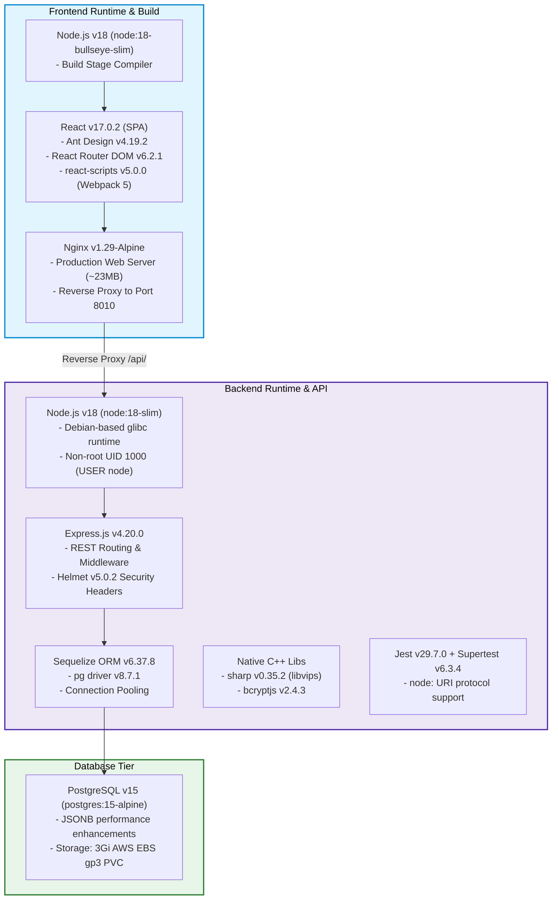
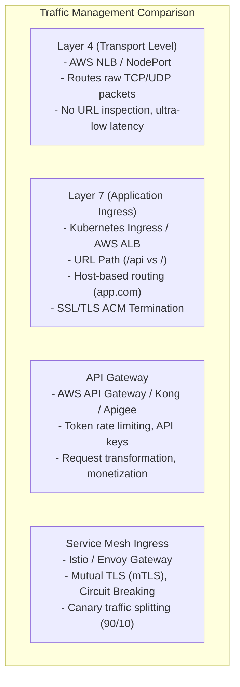

# Project Deep Dive: Versions, Gateways & Ingress Best Practices

> **Target Experience Range:** 1 to 4 Years DevOps / Cloud / Platform Engineer  
> **Core Focus:** Exact technology versions across the stack, rationale for version selections, Gateways vs. Ingress vs. Load Balancers, and enterprise Ingress production best practices.

---

## 1. Complete Technology Versions & Architectural Rationale

Interviewers often test whether you truly understand the tools and runtimes in your stack or just copy-pasted configuration files.



---

### A. Node.js & JavaScript Runtime (`Node.js 18 LTS`)
* **Exact Base Images Used:** `node:18-slim` (Backend) and `node:18-bullseye-slim` (Frontend Builder).
* **Q: Why did you choose Node.js 18 LTS instead of Node 16 or Node 20/22?**
  * **Answer:** "Node.js 18 was chosen because it is an Active Long-Term Support (LTS) release with enterprise stability. It includes the updated **V8 10.2 JavaScript engine**, native `fetch` API support, enhanced OpenSSL 3.0 cryptographic performance, and native ECMAScript Modules (ESM) resolution. While Node 20/22 are newer, Node 18 guarantees 100% stable compatibility with our native binary packages like `sharp` (libvips image processing) and older React build scripts without unexpected glibc breaking changes."
* **Q: Why `node:18-slim` over `node:18-alpine` for the API server?**
  * **Answer:** "Alpine Linux uses `musl libc`, whereas standard Debian uses `glibc`. Packages like `sharp` (used for user profile image resizing) and `bcryptjs` compile native C/C++ bindings against standard `glibc`. In Alpine, prebuilt binaries often fail or require installing large build dependencies (`python3`, `make`, `g++`) during `docker build`, which defeats Alpine's size advantage. `node:18-slim` provides Debian stability and native compatibility with a compact footprint (~180MB)."

---

### B. React & Frontend Stack (`React 17.0.2` & `Nginx 1.29-Alpine`)
* **Versions Used:**
  * **React:** `v17.0.2` (with `react-dom: v17.0.2`)
  * **UI Component Library:** `antd: v4.19.2` (Ant Design 4)
  * **Client Routing:** `react-router-dom: v6.2.1`
  * **Build Tool:** `react-scripts: v5.0.0` (Webpack 5)
  * **Production Server:** `nginx:1.29-alpine`
* **Q: Why serve React via Nginx rather than running `npm start` or Node.js in production?**
  * **Answer:** "React is a Single Page Application (SPA). During build time (`npm run build`), Webpack compiles JSX, TypeScript, and CSS into static assets (HTML, JS bundles, and CSS files). Serving static files through a Node.js process wastes CPU and RAM on V8 event loops. **Nginx is an event-driven C-based web server** that uses asynchronous non-blocking worker processes, capable of serving tens of thousands of static requests per second using direct `sendfile` kernel calls with negligible RAM (~10MB)."

---

### C. PostgreSQL Database (`PostgreSQL 15 Alpine`)
* **Version Used:** `postgres:15-alpine` (with `sequelize: v6.37.8` and `pg: v8.7.1`).
* **Q: What new features in PostgreSQL 15 make it superior to Postgres 12/13/14?**
  * **Answer:**
    1. **Performance Improvements:** PostgreSQL 15 introduces major sorting improvements (up to 400% faster in-memory and on-disk sorting) and improved JSONB compression.
    2. **`MERGE` SQL Command:** Supports standard ANSI SQL `MERGE` statements for atomic conditional insert/update/delete operations.
    3. **Logical Replication Enhancements:** Allows row filtering and column lists during logical replication, crucial when setting up read replicas or multi-region data streams.
    4. **Server-Level Logging:** Structured `jsonlog` output format, making log ingestion into Grafana Loki, Datadog, or AWS CloudWatch significantly easier to parse.

---

### D. Testing & Quality Harness (`Jest 29.7.0`)
* **Versions Used:** `jest: v29.7.0`, `supertest: v6.3.4`, `uuid: v9.0.1`.
* **Q: You upgraded from Jest 25 to Jest 29. Why was this upgrade necessary?**
  * **Answer:** "Jest 25 could not resolve modern Node.js packages that use the `node:` URI protocol prefix (e.g. `require('node:fs')` or `node:stream` introduced in recent versions of `sharp` and `formidable`). Upgrading to **Jest 29** resolved the module resolution errors natively, added full compatibility with Babel presets, and enabled accurate code coverage reporting matching our 50% Quality Gate threshold."

---

## 2. Gateways, Ingress & Routing Architectures



---

### Q1. What gateway or routing mechanism is currently implemented in your project?
* **Current Project Architecture:**
  * **Edge Ingress:** We use an **AWS Application Load Balancer** provisioned automatically by Kubernetes via `clientsrc.yaml` (`spec.type: LoadBalancer`).
  * **Application Routing:** The AWS Load Balancer sends all traffic on port 80 to the `client-app` Pod. Inside the pod, **Nginx acts as the Layer 7 Reverse Proxy**:
    * Requests matching `/` $\implies$ Served directly from `/usr/share/nginx/html` (React build).
    * Requests matching `/api/` $\implies$ Forwarded internally via `proxy_pass http://apiserver-service:8010/` to the Express ClusterIP Service.

---

### Q2. What is the difference between an API Gateway, an Ingress Controller, and a Load Balancer?

| Dimension | Cloud Load Balancer (ALB/NLB) | Kubernetes Ingress Controller | API Gateway (Kong, AWS API GW, Apigee) |
| :--- | :--- | :--- | :--- |
| **Primary Scope** | Entrypoint into AWS VPC from the public internet. | Cluster-wide reverse proxy routing traffic to Kubernetes Services. | Application-level API management, governance, and security. |
| **Routing Layer** | Layer 4 (NLB) or Layer 7 (ALB). | Layer 7 (Host, Path, Header matching). | Layer 7 + Business Logic. |
| **Key Features** | High availability, DDoS protection (AWS Shield), health checks. | Path routing, SSL termination, multi-service routing sharing 1 IP. | Rate limiting per API key, OAuth2 validation, request caching, analytics. |
| **Where it Sits** | Outside the Kubernetes cluster. | Inside the Kubernetes cluster (or provisions an ALB). | Edge of the network or fronting microservices. |

---

### Q3. What is the Kubernetes Gateway API and how does it differ from traditional Ingress?
* **Traditional Ingress (`networking.k8s.io/v1`):**
  * Monolithic manifest where routing rules, TLS, and backend targets are mixed together.
  * Relies heavily on custom, vendor-specific annotations (e.g. `alb.ingress.kubernetes.io/*` or `nginx.ingress.kubernetes.io/*`), making manifests non-portable between cloud providers.
* **Kubernetes Gateway API (`gateway.networking.k8s.io`):**
  * The modern, role-oriented standard that replaces Ingress.
  * Decouples responsibilities into distinct resources:
    1. **`GatewayClass`:** Managed by Cloud/Infrastructure Provider (defines LB type).
    2. **`Gateway`:** Managed by Cluster Operators (defines listening ports, TLS certs, IP addresses).
    3. **`HTTPRoute` / `GRPCRoute`:** Managed by Application Developers (defines path matching `/api/v1` and backend service routing).

---

## 3. Enterprise Ingress Best Practices

When deploying Ingress in enterprise production on AWS EKS, interviewers expect you to know the following production hardening standards:

```mermaid
flowchart TD
    Client["Client HTTPS Request"] -->|TLS 1.3 Port 443| ALB["AWS Application Load Balancer\n(Managed by AWS LB Controller)"]
    
    subgraph Security_Layer["Security & Governance"]
        WAF["AWS WAF (Web Application Firewall)\n- SQL Injection Protection\n- Cross-Site Scripting (XSS)\n- Rate Limiting (2000 req/5min)"]
        ACM["AWS Certificate Manager (ACM)\n- Automated SSL/TLS 1.3 Renewal"]
    end
    
    ALB -.-> WAF
    ALB -.-> ACM
    
    subgraph EKS_Routing["EKS Ingress Routing"]
        IngressSpec["Ingress Resource (alb.ingress.kubernetes.io)"]
        IngressSpec -->|Target Type: IP (Direct Pod Routing)| NodePods["Pod: client-server (10.0.1.45:80)\nPod: apiserver (10.0.2.112:8010)"]
    end
    
    ALB ==> IngressSpec
```

---

### 1. SSL/TLS Termination with AWS Certificate Manager (ACM)
* **Practice:** Offload SSL handshake decryption from backend pods to the AWS ALB.
* **Configuration:**
  ```yaml
  apiVersion: networking.k8s.io/v1
  kind: Ingress
  metadata:
    name: main-ingress
    namespace: node-react-app
    annotations:
      kubernetes.io/ingress.class: alb
      alb.ingress.kubernetes.io/scheme: internet-facing
      alb.ingress.kubernetes.io/certificate-arn: arn:aws:acm:ap-south-1:123456789012:certificate/abc-123-def
      alb.ingress.kubernetes.io/ssl-policy: ELBSecurityPolicy-TLS13-1-2-2021-06
      alb.ingress.kubernetes.io/listen-ports: '[{"HTTP": 80}, {"HTTPS": 443}]'
      alb.ingress.kubernetes.io/ssl-redirect: '443'
  ```

---

### 2. Target Type: `ip` vs. `instance` Mode
* **`instance` Mode (Default):** ALB routes to worker node NodePorts $\to$ Kube-Proxy uses iptables $\to$ forwarded to Pod IP. Adds an extra network hop and uneven load distribution.
* **`ip` Mode (Best Practice on EKS with AWS VPC CNI):** ALB routes traffic **directly to Pod IP addresses** bypassing NodePort and kube-proxy iptables overhead, reducing network latency and improving health check precision.
  ```yaml
  alb.ingress.kubernetes.io/target-type: ip
  ```

---

### 3. Graceful Connection Draining & Deregistration Delay
* **Problem:** During a rolling update, Kubernetes terminates old pods. If the Load Balancer continues forwarding traffic to terminated pods, users experience HTTP 502/504 errors.
* **Best Practice:** Configure deregistration delay and a container `preStop` sleep hook:
  ```yaml
  metadata:
    annotations:
      alb.ingress.kubernetes.io/target-group-attributes: deregistration_delay.timeout_seconds=30
  ```
  ```yaml
  # Inside Pod Spec
  lifecycle:
    preStop:
      exec:
        command: ["/bin/sh", "-c", "sleep 15"]
  ```

---

### 4. Integrating AWS WAF (Web Application Firewall)
* Protects Ingress endpoints against Layer 7 DDoS attacks, SQL Injection (SQLi), and Cross-Site Scripting (XSS) at the edge before traffic enters your Kubernetes cluster:
  ```yaml
  alb.ingress.kubernetes.io/wafv2-acl-arn: arn:aws:wafv2:ap-south-1:123456789012:regional/webacl/skills-waf-acl/xyz-789
  ```

---

### 5. Timeouts & Buffer Size Tuning
* **Proxy Timeouts:** For long-running image upload operations (`sharp`/`formidable` profile pictures in Express), set proxy timeouts to prevent premature socket termination:
  ```nginx
  proxy_connect_timeout 60s;
  proxy_send_timeout 60s;
  proxy_read_timeout 60s;
  client_max_body_size 10M;
  ```

---

## 4. Top Interview Questions on Versions, Gateways & Ingress

### Q1. "If you upgrade Node.js from 18 to Node.js 20 in your API Dockerfile tomorrow, what could break?"
* **Model Answer:**
  * "First, **Native C++ bindings**: Packages like `sharp` and `bcryptjs` compile against specific Node-API / V8 versions. If prebuilt binaries aren't available for the new V8 ABI, `npm ci` may fail during Docker build unless compilation tools are present.
  * Second, **OpenSSL 3.0 Strict Ciphers**: Node 20 enforces stricter legacy cryptographic cipher restrictions which might affect older JWT signing algorithms or database SSL connections.
  * Third, **Babel & Jest Configuration**: Our test harness in `babel.config.js` and Jest 29 must support the newer AST parsing rules of Node 20."

---

### Q2. "Why does Nginx in your client pod have `try_files $uri $uri/ /index.html;`?"
* **Model Answer:**
  * "React Router performs **client-side routing** in the browser. When a user directly visits or refreshes `http://example.com/skills/edit/5`, no physical file exists on the Nginx filesystem at `/usr/share/nginx/html/skills/edit/5`.
  * Without `try_files`, Nginx returns an **HTTP 404 Not Found**.
  * The directive `try_files $uri $uri/ /index.html;` tells Nginx: *'If the requested file or directory does not exist on disk, serve `index.html` with HTTP 200 and let React Router handle the URL path in JavaScript.'*"

---

### Q3. "How would you implement Canary deployments at the Ingress level without Service Mesh?"
* **Model Answer:**
  * "Using **Nginx Ingress Annotations** or **AWS ALB Target Group Weights**:
    1. Deploy the new application version as a separate Deployment (`apiserver-canary`) and Service (`apiserver-canary-svc`).
    2. Define a second Ingress manifest targeting `apiserver-canary-svc` annotated with:
       ```yaml
       nginx.ingress.kubernetes.io/canary: "true"
       nginx.ingress.kubernetes.io/canary-weight: "10"
       ```
    3. The Ingress controller dynamically routes **10% of user traffic to the Canary** and **90% to the Stable version**. We monitor HTTP 5xx metrics in Prometheus; if error rates remain clean, we promote the canary to 100%."
