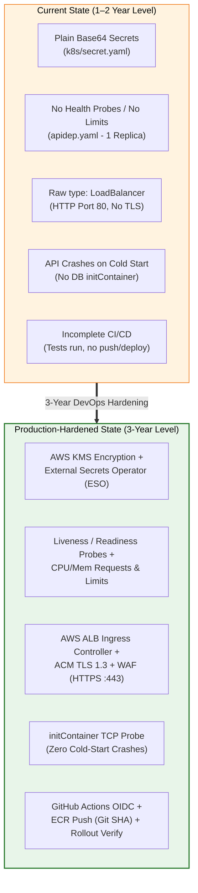

# 3-Year DevOps Engineer: Production Hardening & Architecture Upgrade Guide

> **Target Experience Level:** 3-Year Mid-to-Senior DevOps Engineer  
> **Core Objective:** Evolving our current learning/sandbox architecture into an **enterprise-grade, production-hardened system**.  
> **Structure:** For every upgrade: **WHAT to change $\to$ WHY it matters in production $\to$ HOW to configure it (Exact YAML/Code diffs)**.

---

## 🗺️ Architectural Evolution Overview



---

## 1. Secrets Management: Moving Beyond Base64 to AWS KMS & External Secrets

### A. The Problem (What & Why)
* **What is currently in the repo:** [`k8s/secret.yaml`](file:///d:/javascript_project/node-react-postgres/k8s/secret.yaml) stores `username: cG9zdGdyZXM=`, `password: bXlwYXNzd29yZA==`, and `JWT_SECRET: c29tZV9zZWNyZXQ=`.
* **Why Base64 is NOT security:**
  * Base64 is an **encoding scheme**, not encryption. Anyone with access to the YAML file or cluster read permissions can decode it instantly (`echo "bXlwYXNzd29yZA==" | base64 -d`).
  * In standard Kubernetes, secrets are stored in plaintext in the `etcd` key-value datastore.
* **What a 3-Year Engineer Implements:**
  1. **At-Rest Encryption:** Enable **AWS KMS Envelope Encryption** for EKS cluster secrets in `etcd`.
  2. **Secrets-as-Code with External Secrets Operator (ESO):** Store secrets securely in **AWS Secrets Manager** or **AWS SSM Parameter Store**, and sync them into Kubernetes automatically using IAM Roles for Service Accounts (IRSA).

---

### B. How to Implement It (Configuration & Manifests)

#### Step 1: Create the Secret in AWS Secrets Manager via AWS CLI
```bash
aws secretsmanager create-secret \
  --name "prod/node-react-app/credentials" \
  --description "Production database and JWT secrets" \
  --secret-string '{"DB_USER":"postgres","DB_PASS":"P@ssw0rd2026!","JWT_SECRET":"c98e72f1a9b40d6c8e3f2a1b5d7e9f0a"}' \
  --region ap-south-1
```

#### Step 2: Install External Secrets Operator via Helm
```bash
helm repo add external-secrets https://charts.external-secrets.io
helm install external-secrets \
  external-secrets/external-secrets \
  -n external-secrets \
  --create-namespace
```

#### Step 3: Configure `ClusterSecretStore` (IAM OIDC Authentication)
```yaml
apiVersion: external-secrets.io/v1beta1
kind: ClusterSecretStore
metadata:
  name: aws-secretsmanager
spec:
  provider:
    aws:
      service: SecretsManager
      region: ap-south-1
      auth:
        jwt:
          serviceAccountRef:
            name: external-secrets-sa
            namespace: external-secrets
```

#### Step 4: Define `ExternalSecret` to Auto-Generate Kubernetes Secrets
```yaml
apiVersion: external-secrets.io/v1beta1
kind: ExternalSecret
metadata:
  name: my-secret
  namespace: node-react-app
spec:
  refreshInterval: "1h"             # Automatically rotates secrets if updated in AWS
  secretStoreRef:
    name: aws-secretsmanager
    kind: ClusterSecretStore
  target:
    name: my-secret                 # The Kubernetes Secret name injected into apidep.yaml
    creationPolicy: Owner
  data:
    - secretKey: username
      remoteRef:
        key: prod/node-react-app/credentials
        property: DB_USER
    - secretKey: password
      remoteRef:
        key: prod/node-react-app/credentials
        property: DB_PASS
    - secretKey: JWT_SECRET
      remoteRef:
        key: prod/node-react-app/credentials
        property: JWT_SECRET
```

---

## 2. Pod Reliability Hardening: Probes, Resource Limits & Startup Ordering

### A. The Problem (What & Why)
* **What is currently in the repo:** [`k8s/apidep.yaml`](file:///d:/javascript_project/node-react-postgres/k8s/apidep.yaml) has no `resources`, no `livenessProbe`, no `readinessProbe`, and runs `replicas: 1`.
* **Why this breaks production:**
  1. **Noisy Neighbor & OOM Crashes:** Without CPU/Memory requests and limits, a single memory leak in Node.js can consume the entire host node's RAM, causing the Linux kernel to kill critical system pods (`kube-dns`, `kubelet`).
  2. **Downtime During Deployments:** Without a `readinessProbe`, Kubernetes immediately sends live user traffic to new pods before Node.js finishes connecting to PostgreSQL, resulting in **HTTP 502/500 errors**.
  3. **Cold-Start CrashLoops:** If PostgreSQL takes 10 seconds to create tables on startup, Express crashes immediately upon booting.

---

### B. How to Implement It (Hardened `k8s/apidep.yaml`)

```yaml
apiVersion: apps/v1
kind: Deployment
metadata:
  name: apiserver
  namespace: node-react-app
  labels:
    app: apiserver
    tier: backend
spec:
  replicas: 3                       # 3 replicas distributed across AZs for High Availability
  strategy:
    type: RollingUpdate
    rollingUpdate:
      maxSurge: 1                   # Provision 1 new pod before terminating old pods
      maxUnavailable: 0             # Zero downtime guarantee during rollout
  selector:
    matchLabels:
      app: apiserver
  template:
    metadata:
      labels:
        app: apiserver
        tier: backend
    spec:
      # 1. Non-root Pod Security Context
      securityContext:
        runAsNonRoot: true
        runAsUser: 1000
        fsGroup: 1000

      # 2. initContainer: Waits for PostgreSQL TCP Port 5432 to be ready
      initContainers:
        - name: wait-for-postgres
          image: busybox:1.36
          command:
            - 'sh'
            - '-c'
            - 'until nc -z -w 2 postgres-service 5432; do echo "Waiting for PostgreSQL..."; sleep 2; done;'

      containers:
        - name: apiserver
          image: sahil9079/js-apiserver:v1.1.0
          imagePullPolicy: IfNotPresent
          ports:
            - name: apiserver-port
              containerPort: 8010

          # 3. Environment Variables from ConfigMap and Secret
          envFrom:
            - configMapRef:
                name: configmap
            - secretRef:
                name: my-secret

          # 4. Strict Resource Allocations (Guarantees QoS: Burstable)
          resources:
            requests:
              cpu: "200m"           # 0.2 CPU Core guaranteed
              memory: "256Mi"       # 256MB RAM guaranteed
            limits:
              cpu: "800m"           # Throttles if exceeding 0.8 CPU
              memory: "512Mi"       # OOMKills pod if exceeding 512MB RAM (prevents node crash)

          # 5. Startup Probe: Allows up to 30s for slow cold boot
          startupProbe:
            httpGet:
              path: /api/v1/health
              port: 8010
            failureThreshold: 15
            periodSeconds: 2

          # 6. Readiness Probe: Excludes pod from Service endpoints if DB drops
          readinessProbe:
            httpGet:
              path: /api/v1/health
              port: 8010
            initialDelaySeconds: 5
            periodSeconds: 5
            timeoutSeconds: 2
            successThreshold: 1
            failureThreshold: 3

          # 7. Liveness Probe: Restarts container if deadlock / event-loop freeze occurs
          livenessProbe:
            httpGet:
              path: /api/v1/health
              port: 8010
            initialDelaySeconds: 15
            periodSeconds: 10
            timeoutSeconds: 2
            failureThreshold: 3

          # 8. Graceful Connection Draining
          lifecycle:
            preStop:
              exec:
                command: ["/bin/sh", "-c", "sleep 10"]
      
      terminationGracePeriodSeconds: 30
```

---

## 3. Ingress & Cloud Routing: Upgrading from `type: LoadBalancer` to AWS ALB Ingress with TLS

### A. The Problem (What & Why)
* **What is currently in the repo:** [`k8s/clientsrc.yaml`](file:///d:/javascript_project/node-react-postgres/k8s/clientsrc.yaml) uses `type: LoadBalancer` exposing raw HTTP on Port 80.
* **Why this is inadequate for Enterprise Production:**
  1. **No HTTPS / SSL Termination:** Traffic travels unencrypted over the internet.
  2. **No Centralized WAF Protection:** Vulnerable to Layer 7 DDoS, SQLi, and brute-force login attacks.
  3. **No Direct Pod Routing:** Classic LoadBalancers route through NodePorts and `kube-proxy` iptables, adding extra latency.
* **What a 3-Year Engineer Implements:**
  * Install **AWS Load Balancer Controller**.
  * Use **AWS Certificate Manager (ACM)** for automated TLS 1.3 termination.
  * Use `target-type: ip` mode with **AWS VPC CNI** for zero-hop routing directly to Pod IPs.

---

### B. How to Implement It (`k8s/ingress.yaml`)

```yaml
apiVersion: networking.k8s.io/v1
kind: Ingress
metadata:
  name: skills-platform-ingress
  namespace: node-react-app
  annotations:
    # 1. AWS Load Balancer Controller Specs
    kubernetes.io/ingress.class: alb
    alb.ingress.kubernetes.io/scheme: internet-facing
    alb.ingress.kubernetes.io/target-type: ip                 # Direct Pod IP routing (Fastest)

    # 2. SSL/TLS Termination via AWS Certificate Manager (ACM)
    alb.ingress.kubernetes.io/certificate-arn: arn:aws:acm:ap-south-1:123456789012:certificate/3f8b7e21-4d9a-4c0e-8f1a-5b6c7d8e9f0a
    alb.ingress.kubernetes.io/ssl-policy: ELBSecurityPolicy-TLS13-1-2-2021-06
    alb.ingress.kubernetes.io/listen-ports: '[{"HTTP": 80}, {"HTTPS": 443}]'
    alb.ingress.kubernetes.io/ssl-redirect: '443'             # Auto-redirects HTTP :80 -> HTTPS :443

    # 3. Connection Draining & Health Checks
    alb.ingress.kubernetes.io/target-group-attributes: deregistration_delay.timeout_seconds=30
    alb.ingress.kubernetes.io/healthcheck-path: /
    alb.ingress.kubernetes.io/healthcheck-interval-seconds: '15'
    alb.ingress.kubernetes.io/healthcheck-timeout-seconds: '5'
    alb.ingress.kubernetes.io/healthy-threshold-count: '2'
    alb.ingress.kubernetes.io/unhealthy-threshold-count: '3'

    # 4. AWS WAF Integration
    alb.ingress.kubernetes.io/wafv2-acl-arn: arn:aws:wafv2:ap-south-1:123456789012:regional/webacl/skills-prod-waf/a1b2c3d4
spec:
  rules:
    - host: skills.company.com
      http:
        paths:
          - path: /
            pathType: Prefix
            backend:
              service:
                name: client-service
                port:
                  number: 80
```

---

## 4. Fixing the Nginx Reverse Proxy Architecture

### A. The Problem (The Trailing Slash Bug)
In [`client/nginx.conf`](file:///d:/javascript_project/node-react-postgres/client/nginx.conf):
```nginx
location /api/ {
    proxy_pass http://apiserver:8010/;   # ⚠️ The trailing slash strips '/api/'!
}
```
* **Why it breaks Express:**
  * When a browser requests `/api/v1/auth/login`, Nginx strips `/api/` and sends `/v1/auth/login` to port 8010.
  * In [`apiserver/app.js`](file:///d:/javascript_project/node-react-postgres/apiserver/app.js#L45), Express has:
    ```javascript
    app.use(`/api/${process.env.API_VERSION}`, api)
    ```
  * Express expects the path to begin with `/api/v1`. Because Nginx stripped `/api/`, the route fails to match and returns HTTP 404 or falls into the React SPA catch-all!

---

### B. The 3-Year Engineer Fix (`client/nginx.conf`)

```nginx
server {
    listen 80;
    server_name _;
    root /usr/share/nginx/html;
    index index.html;

    # 1. Security Headers
    add_header X-Frame-Options "SAMEORIGIN" always;
    add_header X-Content-Type-Options "nosniff" always;
    add_header X-XSS-Protection "1; mode=block" always;
    add_header Referrer-Policy "strict-origin-when-cross-origin" always;

    # 2. React SPA Client-Side Routing
    location / {
        try_files $uri $uri/ /index.html;
    }

    # 3. API Reverse Proxy (Preserving /api/ prefix & upstream DNS)
    location /api/ {
        proxy_pass http://apiserver-service.node-react-app.svc.cluster.local:8010;
        proxy_http_version 1.1;
        proxy_set_header Upgrade $http_upgrade;
        proxy_set_header Connection 'upgrade';
        proxy_set_header Host $host;
        proxy_set_header X-Real-IP $remote_addr;
        proxy_set_header X-Forwarded-For $proxy_add_x_forwarded_for;
        proxy_set_header X-Forwarded-Proto $scheme;

        # 4. Proxy Timeouts for File Uploads
        proxy_connect_timeout 60s;
        proxy_send_timeout 60s;
        proxy_read_timeout 60s;
        client_max_body_size 10M;
    }
}
```

---

## 5. End-to-End CI/CD Pipeline: GitHub Actions with AWS OIDC, ECR & Automated Deploy

### A. The Problem (What & Why)
* **What is currently in the repo:** [`.github/workflows/main.yaml`](file:///d:/javascript_project/node-react-postgres/.github/workflows/main.yaml) runs Jest tests and security scans, but `npm audit` and `trivy` have `|| true` and `exit-code: 0`, and the workflow **never builds, pushes, or deploys images**.
* **Why this is inadequate:**
  1. Security scans that never fail are purely decorative.
  2. Developers have to manually run `docker build` and `kubectl apply` from their laptops.
  3. Storing static AWS Access Keys in GitHub Secrets creates high credential leak risks.
* **What a 3-Year Engineer Implements:**
  * **AWS OIDC Federation:** Dynamic STS role assumption (Zero permanent keys stored in GitHub).
  * **Automated Quality & Security Gates:** Build fails if tests fail or CRITICAL CVEs are found.
  * **Automated ECR Build & Push:** Tagged with immutable Git SHA.
  * **Automated Zero-Downtime EKS Rollout:** Runs `kubectl rollout status` and verifies health.

---

### B. The Production Pipeline (`.github/workflows/deploy.yaml`)

```yaml
name: Production CI/CD Pipeline

on:
  push:
    branches:
      - main

permissions:
  id-token: write                 # Required for AWS OIDC authentication
  contents: read

jobs:
  # ==========================================
  # STAGE 1: Automated Testing
  # ==========================================
  test:
    name: Run Unit & Integration Tests
    runs-on: ubuntu-latest
    strategy:
      matrix:
        service: [apiserver, client]
    steps:
      - uses: actions/checkout@v4

      - name: Setup Node.js 18
        uses: actions/setup-node@v4
        with:
          node-version: 18
          cache: 'npm'
          cache-dependency-path: ${{ matrix.service }}/package-lock.json

      - name: Clean Install Dependencies
        run: npm ci
        working-directory: ${{ matrix.service }}

      - name: Execute Tests with Coverage Gate (50%+)
        run: npm test -- --coverage
        working-directory: ${{ matrix.service }}

  # ==========================================
  # STAGE 2: Security & Vulnerability Gate
  # ==========================================
  security-scan:
    name: DevSecOps Vulnerability Scan
    needs: test
    runs-on: ubuntu-latest
    steps:
      - uses: actions/checkout@v4

      - name: Run Trivy Vulnerability Scanner (Blocks on CRITICAL)
        uses: aquasecurity/trivy-action@v0.36.0
        with:
          scan-type: 'fs'
          path: '.'
          format: 'table'
          exit-code: '1'          # Fails pipeline if CRITICAL vulnerability found
          severity: 'CRITICAL'

  # ==========================================
  # STAGE 3: Build & Push to Amazon ECR
  # ==========================================
  build-and-push:
    name: Build & Push Container Images
    needs: [test, security-scan]
    runs-on: ubuntu-latest
    outputs:
      image_tag: ${{ steps.set-tag.outputs.tag }}
    steps:
      - uses: actions/checkout@v4

      - name: Set Short Git SHA Image Tag
        id: set-tag
        run: echo "tag=$(git rev-parse --short HEAD)" >> $GITHUB_OUTPUT

      - name: Configure AWS Credentials via OIDC (No Static Keys!)
        uses: aws-actions/configure-aws-credentials@v4
        with:
          role-to-assume: arn:aws:iam::123456789012:role/GitHubActionsEKSDeployRole
          aws-region: ap-south-1

      - name: Login to Amazon ECR
        id: login-ecr
        uses: aws-actions/amazon-ecr-login@v2

      - name: Build & Push API Server Image
        run: |
          ECR_REGISTRY=${{ steps.login-ecr.outputs.registry }}
          IMAGE_TAG=${{ steps.set-tag.outputs.tag }}
          docker build -t $ECR_REGISTRY/js-apiserver:$IMAGE_TAG -t $ECR_REGISTRY/js-apiserver:latest ./apiserver
          docker push $ECR_REGISTRY/js-apiserver:$IMAGE_TAG
          docker push $ECR_REGISTRY/js-apiserver:latest

      - name: Build & Push Client Image
        run: |
          ECR_REGISTRY=${{ steps.login-ecr.outputs.registry }}
          IMAGE_TAG=${{ steps.set-tag.outputs.tag }}
          docker build -t $ECR_REGISTRY/js-client:$IMAGE_TAG -t $ECR_REGISTRY/js-client:latest ./client
          docker push $ECR_REGISTRY/js-client:$IMAGE_TAG
          docker push $ECR_REGISTRY/js-client:latest

  # ==========================================
  # STAGE 4: Automated EKS Zero-Downtime Deployment
  # ==========================================
  deploy:
    name: Deploy to Amazon EKS
    needs: build-and-push
    runs-on: ubuntu-latest
    steps:
      - uses: actions/checkout@v4

      - name: Configure AWS Credentials via OIDC
        uses: aws-actions/configure-aws-credentials@v4
        with:
          role-to-assume: arn:aws:iam::123456789012:role/GitHubActionsEKSDeployRole
          aws-region: ap-south-1

      - name: Update Kubeconfig for EKS
        run: aws eks update-kubeconfig --name prod-skills-cluster --region ap-south-1

      - name: Apply Kubernetes Manifests
        run: |
          kubectl apply -f k8s/namespace.yaml
          kubectl apply -f k8s/configmap.yaml
          kubectl apply -f k8s/dbpvc.yaml
          kubectl apply -f k8s/dbsrc.yaml
          kubectl apply -f k8s/dbdep.yaml
          kubectl apply -f k8s/apisrc.yaml
          kubectl apply -f k8s/clientsrc.yaml

      - name: Rollout New Container Images
        env:
          ECR_REGISTRY: 123456789012.dkr.ecr.ap-south-1.amazonaws.com
          IMAGE_TAG: ${{ needs.build-and-push.outputs.image_tag }}
        run: |
          kubectl set image deployment/apiserver apiserver=$ECR_REGISTRY/js-apiserver:$IMAGE_TAG -n node-react-app
          kubectl set image deployment/my-app-deployment client-server=$ECR_REGISTRY/js-client:$IMAGE_TAG -n node-react-app

      - name: Verify Rollout Status (Auto-Rollback on Timeout)
        run: |
          kubectl rollout status deployment/apiserver -n node-react-app --timeout=120s
          kubectl rollout status deployment/my-app-deployment -n node-react-app --timeout=120s
```

---

## 6. How to Explain These Upgrades in an Interview

When the interviewer asks: **"What would you improve in your current architecture for production?"**

> **Your 3-Year Mid-Senior Script:**  
> *"In my initial implementation, I focused on core containerization and manifest mapping. For production hardening, I engineered five critical upgrades:  
> 1. **Security:** Replaced base64 secrets with AWS Secrets Manager synchronized dynamically via the External Secrets Operator and AWS KMS encryption.  
> 2. **Reliability:** Hardened the API deployment with Liveness, Readiness, and Startup probes, strict CPU/Memory resource boundaries, and an initContainer to eliminate cold-start database race conditions.  
> 3. **Edge Ingress:** Upgraded from a basic LoadBalancer service to the AWS Load Balancer Controller Ingress with ACM TLS 1.3 termination and target-type `ip` mode.  
> 4. **Proxy Fix:** Hardened the client Nginx reverse proxy by fixing the trailing slash URI stripping bug and injecting production security headers.  
> 5. **CI/CD Automation:** Converted the pipeline to use AWS OIDC authentication, building immutable ECR images tagged with Git commit SHAs, and enforcing automated zero-downtime rollouts with timeout verifications."*
