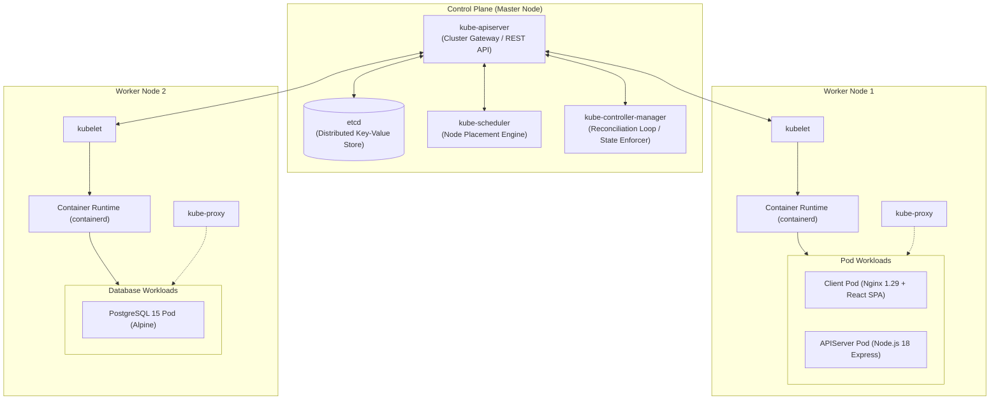
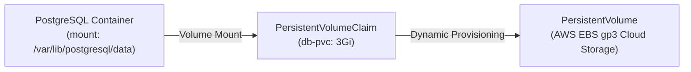
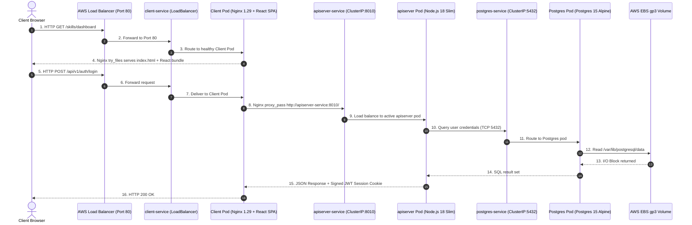

# Kubernetes (K8s) Architecture & Production Deep Dive

> **Project:** FullStack DevOps Pipeline — Skills Management Platform  
> **Scope:** Complete Kubernetes Architecture, Manifest Breakdown, Ingress/Networking, Storage, and Production Operations  
> **Namespace:** `node-react-app`  
> **Status:** Production Reference Documentation & Interview Defense

---

## 1. Executive Overview: What is Kubernetes & Why Do We Need It?

**Kubernetes (K8s)** is an open-source container orchestration engine that automates the **deployment, scaling, networking, and self-healing** of containerized applications across a distributed cluster of worker nodes.

### Evolution: Docker vs. Kubernetes in Production

| Feature | Docker / Docker Compose (Single Host) | Kubernetes (Cluster-Wide Orchestration) |
| :--- | :--- | :--- |
| **Node Architecture** | Single machine; host failure brings down all services. | Multi-node cluster with automated workload re-scheduling. |
| **Self-Healing** | Simple `restart: always` on local daemon. | Automatic health probes (Liveness/Readiness), pod replacement across healthy nodes. |
| **Scaling** | Manual port mapping; host port collisions. | Horizontal Pod Autoscaling (HPA) based on CPU/RAM metrics and custom metrics. |
| **Service Discovery** | Static Docker bridge network DNS. | Dynamic ClusterIP services with kube-proxy load balancing and CoreDNS. |
| **Rolling Deployments** | Manual container restart with downtime. | Declarative zero-downtime rolling updates with automatic rollback on failure. |
| **Storage Abstraction** | Host-bound volume mounts (`-v /var/lib/...`). | Cloud-agnostic PersistentVolumes (PV/PVC) backed by cloud storage (AWS EBS gp3). |

---

## 2. Kubernetes Cluster Architecture (Control Plane vs. Worker Nodes)



### 2.1 Control Plane Components
* **`kube-apiserver`**: The central gateway of Kubernetes. Validates and configures data for Pods, Services, ReplicationControllers, and others. All external (`kubectl`) and internal communications go through this API.
* **`etcd`**: Highly-available, consistent key-value store acting as Kubernetes' single source of truth for cluster state and metadata.
* **`kube-scheduler`**: Watches for newly created Pods without assigned nodes, selecting optimal worker nodes based on resource requests, constraints, and affinity rules.
* **`kube-controller-manager`**: Runs controller processes that continuously reconcile current cluster state against desired state (e.g., Node Lifecycle Controller, ReplicaSet Controller, EndpointSlice Controller).

### 2.2 Worker Node Components
* **`kubelet`**: The node agent that ensures containers described in `PodSpecs` are running and healthy.
* **`kube-proxy`**: Network proxy running on each node that maintains network rules (iptables/IPVS) for Service abstraction and ClusterIP routing.
* **`Container Runtime` (e.g., containerd, CRI-O)**: The underlying software responsible for pulling images and executing container processes.

---

## 3. Project Manifest Breakdown & Core Objects

In this repository, the application is organized into **10 Kubernetes manifests** located in [`k8s/`](../../k8s):

```
k8s/
 ├── namespace.yaml     ──► 1. Logical Isolation Boundary
 ├── configmap.yaml     ──► 2. Non-Sensitive Environment Configuration
 ├── secret.yaml        ──► 3. Sensitive Credentials (Base64 Encrypted)
 ├── dbpvc.yaml         ──► 4. Cloud Persistent Storage (3Gi EBS gp3)
 ├── clientdep.yaml     ──► 5. Deployment: React SPA (Nginx)
 ├── clientsrc.yaml     ──► 6. Service: Public LoadBalancer (Port 80)
 ├── apidep.yaml        ──► 7. Deployment: Express REST API (Node.js)
 ├── apisrc.yaml        ──► 8. Service: Internal ClusterIP (Port 8010)
 ├── dbdep.yaml         ──► 9. Deployment: PostgreSQL Database
 └── dbsrc.yaml         ──► 10. Service: Internal ClusterIP (Port 5432)
```

---

### 3.1 Object 1: Namespace (`namespace.yaml`)
Provides virtual cluster isolation for security, RBAC policies, and resource quotas.

```yaml
apiVersion: v1
kind: Namespace
metadata:
  name: node-react-app
```

---

### 3.2 Object 2: ConfigMap & Secret (`configmap.yaml` & `secret.yaml`)
Enforces the 12-Factor App methodology by decoupling application logic from configuration.

* **ConfigMap (Non-Sensitive):**
  ```yaml
  apiVersion: v1
  kind: ConfigMap
  metadata:
    name: configmap
    namespace: node-react-app
  data:
    NODE_ENV: "development"
    PORT_DEV: "8010"
    API_VERSION: "v1"
    DB_HOST: "postgres-service"  # Internal DNS pointing to DB Service
    DB_PORT: "5432"
    DB_NAME: "sampledb"
  ```

* **Secret (Sensitive Credentials):**
  ```yaml
  apiVersion: v1
  kind: Secret
  metadata:
    name: my-secret
    namespace: node-react-app
  type: Opaque
  data:
    username: cG9zdGdyZXM=       # Base64 for 'postgres'
    password: bXlwYXNzd29yZA==   # Base64 for 'mypassword'
    JWT_SECRET: c29tZV9zZWNyZXQ= # Base64 for 'some_secret'
  ```

---

### 3.3 Object 3: Pods & Deployments (`apidep.yaml`)
* **Pod**: The atomic execution unit in Kubernetes containing one or more containers sharing network namespace and storage volumes.
* **Deployment**: High-level declarative controller managing ReplicaSets, automated rollouts, rollbacks, and self-healing.

```yaml
apiVersion: apps/v1
kind: Deployment
metadata:
  name: apiserver
  namespace: node-react-app
  labels:
    app: apiserver
spec:
  replicas: 1
  selector:
    matchLabels:
      app: apiserver
  template:
    metadata:
      labels:
        app: apiserver
    spec:
      containers:
      - name: apiserver
        image: sahil9079/js-apiserver:v1.1.0
        ports:
          - name: apiserver-port
            containerPort: 8010
        envFrom:
          - configMapRef:
               name: configmap
          - secretRef:
               name: my-secret
```

---

### 3.4 Object 4: Services & Networking (`clientsrc.yaml`, `apisrc.yaml`, `dbsrc.yaml`)

#### Why are Services necessary?
Pods are ephemeral. When a pod crashes or scales, Kubernetes assigns a new dynamic IP. A **Service** provides a permanent internal IP and DNS name with built-in round-robin load balancing.

| Service Manifest | Type | Accessibility | Target Port | Role |
| :--- | :--- | :--- | :--- | :--- |
| `clientsrc.yaml` | `LoadBalancer` | Public Web | `80:80` | Provisions an AWS ALB/ELB to direct public user browser traffic to Client Pods. |
| `apisrc.yaml` | `ClusterIP` | Internal Cluster | `8010:8010` | Exposes Express API internally via DNS `http://apiserver-service:8010/`. |
| `dbsrc.yaml` | `ClusterIP` | Internal Cluster | `5432:5432` | Exposes PostgreSQL internally via DNS `postgres-service:5432`. |

```yaml
apiVersion: v1
kind: Service
metadata:
  name: apiserver-service
  namespace: node-react-app
spec:
  type: ClusterIP   
  selector:
    app: apiserver     
  ports:
    - protocol: TCP
      port: 8010 
      targetPort: apiserver-port
```

---

### 3.5 Object 5: Storage Architecture (`dbpvc.yaml` & `dbdep.yaml`)



* **PersistentVolumeClaim (PVC)**: A request for storage by the database pod.
* **PersistentVolume (PV)**: The physical cloud volume (AWS EBS) bound to the claim.
* **Durability**: If the PostgreSQL pod restarts or crashes, Kubernetes mounts the same EBS volume to the newly scheduled pod with zero data loss.

---

## 4. Complete End-to-End Request & Network Flow



---

## 5. Production Operations & `kubectl` Runbook

### 5.1 Deploying the Entire Application
```bash
# Step 1: Create isolated namespace
kubectl apply -f k8s/namespace.yaml

# Step 2: Apply secrets and configuration
kubectl apply -f k8s/secret.yaml
kubectl apply -f k8s/configmap.yaml

# Step 3: Apply storage claim
kubectl apply -f k8s/dbpvc.yaml

# Step 4: Deploy database tier
kubectl apply -f k8s/dbdep.yaml
kubectl apply -f k8s/dbsrc.yaml

# Step 5: Deploy backend and frontend tiers
kubectl apply -f k8s/apidep.yaml
kubectl apply -f k8s/apisrc.yaml
kubectl apply -f k8s/clientdep.yaml
kubectl apply -f k8s/clientsrc.yaml
```

### 5.2 Diagnostic & Observability Commands
```bash
# View all running resources in namespace
kubectl get all -n node-react-app

# Inspect pod details and event logs (diagnose CrashLoopBackOff/Pending)
kubectl describe pod <pod-name> -n node-react-app

# Stream live container logs
kubectl logs -f deployment/apiserver -n node-react-app

# Execute database healthcheck inside pod
kubectl exec -it deployment/postgres-deployment -n node-react-app -- pg_isready -U postgres -d sampledb

# Execute zero-downtime rolling restart
kubectl rollout restart deployment/apiserver -n node-react-app
kubectl rollout status deployment/apiserver -n node-react-app
```
